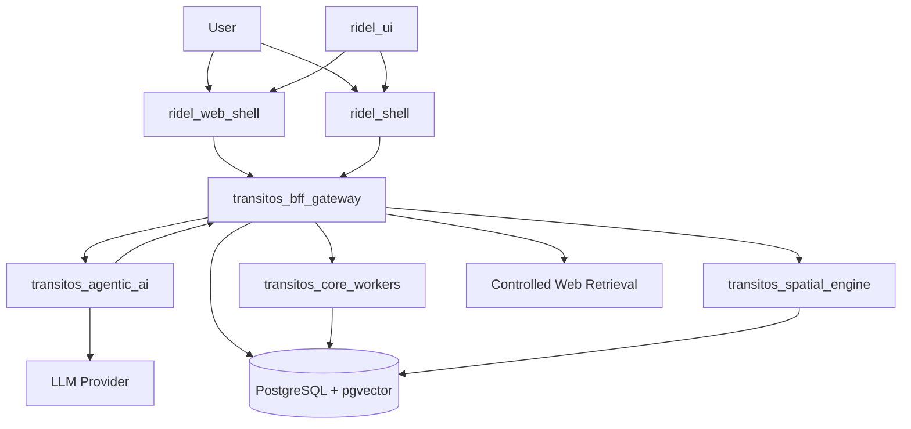
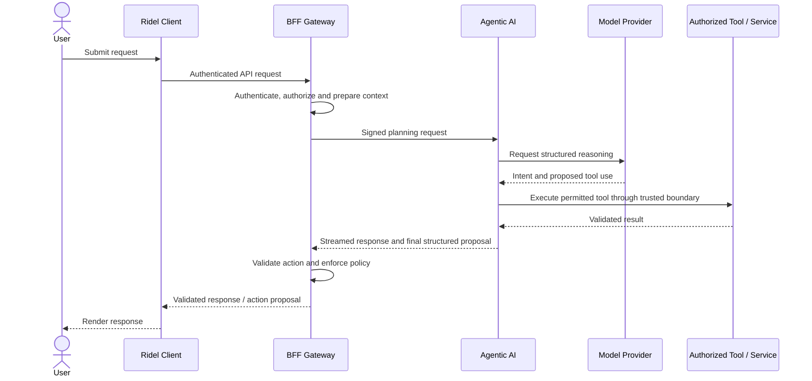

# TRANSITOS Agentic AI

**A secure, modular, multimodal AI agent and orchestration engine for the TRANSITOS ecosystem.**

<p align="center">
  <strong>Understand → Plan → Retrieve → Validate → Act</strong>
</p>

TRANSITOS Agentic AI is the intelligence and orchestration layer of the TRANSITOS ecosystem. It is designed to understand user intent, reason over relevant context, select appropriate tools, retrieve information, propose structured actions, and coordinate with trusted application services.

Rather than building an unrestricted autonomous agent, TRANSITOS follows a controlled, tool-driven architecture in which AI performs reasoning and planning while trusted backend services retain authority over identity, permissions, persistent data, and action execution.

The project is being developed incrementally, with security, predictable behavior, performance, and maintainability as core design requirements.

> **Project status:** Architecture and planning v2.0. Phase 1 has conditional approval for implementation. Production readiness, live-provider performance, and later-phase capabilities must be established through implementation and testing.

---

## 1. What is TRANSITOS Agentic AI?

TRANSITOS Agentic AI is not simply a chatbot or an API wrapper around an LLM.

It is intended to become a reusable intelligence layer that connects language models with application context, approved tools, external information sources, multimodal inputs, and trusted execution services.

For example, a user might ask:

- "Find the fastest route to my office while avoiding tolls."
- "Check whether my usual metro route has any disruptions."
- "Summarize this uploaded metro timetable."
- "Remember my preferred commute route." 
- "Compare the available options and prepare the best one."

The system should understand the request, determine which information is needed, call only authorized tools, validate the resulting information, and return a structured response that Ridel clients can render.

Where an operation requires confirmation, the system must obtain the required approval before the trusted backend executes it.

### Core principles

- **AI proposes; trusted services authorize and execute.**
- **User data remains under explicit application-level access controls.**
- **Tools are typed, allowlisted, bounded, and independently validated.**
- **External content is treated as potentially hostile.**
- **Memory is user-controlled, consent-aware, and deletable.**
- **Performance and reliability are measured, not assumed.**
- **Existing client interfaces are preserved unless a change is justified.**

---

## 2. Where it fits in the TRANSITOS ecosystem

TRANSITOS Agentic AI is one component of a larger system. It does not replace the BFF, application clients, or domain-specific services.



*Conceptual target architecture. Some connections represent planned integrations and are not necessarily implemented yet.*

### Main components

| Component | Responsibility |
|---|---|
| `ridel_ui` | Server-driven UI blueprints, component contracts, actions, and UI definitions. |
| `ridel_shell` | Native application shell and client-side rendering/integration. |
| `ridel_web_shell` | Web application shell and web-side integration. |
| `transitos_bff_gateway` | Trusted API boundary, authentication, authorization, persistence, quotas, confirmations, and action execution. |
| `transitos_agentic_ai` | Stateless-first AI reasoning, intent planning, bounded tool orchestration, and structured responses. |
| `transitos_core_workers` | Planned domain and background data-processing capabilities. |
| `transitos_spatial_engine` | Planned routing and geospatial computation capabilities. |
| PostgreSQL + pgvector | Planned persistent application data, controlled user memory, retrieval indexes, and related records. |

The BFF remains the authoritative boundary between the AI system and privileged application operations.

---

## 3. How a typical AI request works

A typical request follows this lifecycle:



The exact tool-execution path depends on the final service contract. The planner must not bypass BFF authorization to access privileged application data.

### Request lifecycle

1. **Authenticate:** The BFF verifies the user and establishes trusted identity context.
2. **Prepare context:** Only relevant, authorized context is supplied to the planner.
3. **Understand intent:** The model determines what the user is asking for.
4. **Plan:** The planner chooses from permitted tools and structured operations.
5. **Retrieve:** Authorized tools gather the required information.
6. **Validate:** Tool results, schemas, permissions, and source provenance are checked.
7. **Respond:** The planner produces a user-facing response and, when appropriate, a structured action proposal.
8. **Authorize:** The BFF independently checks the proposed action against its canonical policy.
9. **Confirm:** Actions requiring approval remain pending until the required confirmation is verified.
10. **Execute:** The trusted service executes the authorized operation and returns the result.

Not every request needs all ten steps. Simple questions should avoid unnecessary tool calls and model round-trips.

---

## 4. The five development phases

TRANSITOS Agentic AI is planned as five incremental phases. Each phase builds on verified capabilities from the previous one.

<details>
<summary><strong>Phase 1 — Safe Agent Core</strong></summary>

**Goal:** Build the first real end-to-end AI workflow.

Scope:
- Node.js and TypeScript planner service.
- Zod-based request, response, and tool schemas.
- One configured LLM provider.
- BFF-to-planner authentication and request integrity.
- Bounded reasoning and a small set of safe, read-only tools.
- Validated structured action proposals.
- Web SSE and native streaming integration.
- Request deadlines, cancellation, error handling, and cost controls.
- Deterministic security tests and CI checks.

**Exit criteria:** A real user request travels through the client, BFF, planner, and an authorized tool, then returns a validated response. Unauthorized actions, forged requests, and invalid output are rejected.

**Not included by default:** Full long-term memory, general-purpose browsing, autonomous background agents, and unrestricted action execution.

</details>

<details>
<summary><strong>Phase 2 — Persistent Memory & Retrieval</strong></summary>

**Goal:** Give the system controlled access to useful, user-approved context across conversations.

Scope:
- PostgreSQL and pgvector integration.
- BFF-owned persistence and migrations.
- Tenant isolation and row-level security.
- Short-term conversation history and rolling summaries.
- User-approved long-term semantic memory.
- Embedding versioning and hybrid vector/lexical search.
- Memory correction, opt-out, export, expiration, and deletion.
- Attachment ownership and document-chunk access controls.

**Exit criteria:** Cross-user access tests pass, consent behavior is correct, and memory operations remain isolated and controllable.

</details>

<details>
<summary><strong>Phase 3 — Web Research & Grounded Answers</strong></summary>

**Goal:** Allow the agent to retrieve current external information safely.

Scope:
- Search-provider adapters.
- SSRF-hardened HTTP fetching.
- HTML extraction and explicit content-type handling.
- Redirect, DNS, IP, size, and timeout protections.
- Source provenance and structured citations.
- Hostile-content and indirect prompt-injection defenses.
- Controlled outbound network access.
- Optional bounded transit-authority crawling where justified.

**Exit criteria:** The system blocks prohibited network destinations, treats retrieved content as untrusted, and grounds citations in verified tool results.

</details>

<details>
<summary><strong>Phase 4 — Multimodal Understanding</strong></summary>

**Goal:** Support relevant document and image workflows.

Scope:
- Image and PDF processing.
- Bounded text extraction and OCR where necessary.
- Uploaded document retrieval and contextual understanding.
- Model-provider routing based on supported modalities.
- Provider-specific privacy and retention controls.
- Resource limits and isolated parsing for untrusted files.
- Multimodal accuracy and cost evaluations.

**Exit criteria:** Supported files are processed within explicit resource limits, unauthorized attachments cannot be accessed, and provider failures are handled safely.

</details>

<details>
<summary><strong>Phase 5 — Durable Agentic Workflows</strong></summary>

**Goal:** Support reliable, resumable tasks that extend beyond a single interactive request.

Scope:
- Durable workflow execution and checkpointing.
- DBOS or another justified workflow technology.
- Background ingestion and scheduled tasks.
- Idempotent operations and recovery from partial failures.
- Optional isolated browser and crawler workers.
- Expanded observability, operational alerts, and staged rollout controls.

**Exit criteria:** Long-running tasks can recover safely, repeated execution does not duplicate unintended side effects, and failures remain observable and controllable.

</details>

### Phase overview

| Phase | Primary capability | Main prerequisite |
|---|---|---|
| 1 | Safe request-to-response agent | Verified BFF and client contracts |
| 2 | Persistent memory | Database and tenant-security validation |
| 3 | Web research | Secure outbound retrieval boundary |
| 4 | Multimodal understanding | Safe ingestion and provider controls |
| 5 | Durable workflows | Reliable persistence and idempotent operations |

These are planned milestones, not claims that all five phases are already implemented.

---

## 5. Core subsystems

### 5.1 Agent planner and orchestration

The planner converts user intent into a bounded sequence of reasoning and tool operations.

Responsibilities:
- Interpret user intent.
- Select permitted tools.
- Produce schema-valid outputs.
- Incorporate tool results.
- Stop when the task is complete or a defined limit is reached.
- Return structured responses to the BFF.

The planner must not own application authorization, direct database access, or trusted action confirmation.

### 5.2 Tool execution system

Tools give the planner controlled access to useful capabilities.

Potential tool categories include:

- Routing and ETA retrieval.
- Weather and transit information.
- Saved-place retrieval.
- User-approved memory retrieval.
- Web search and safe page extraction.
- Attachment text extraction.
- Future domain-specific operations.

Each tool needs a strict schema, a documented permission scope, timeouts, output-size limits, and explicit failure behavior.

Tool availability should grow only when there is a validated product requirement.

### 5.3 Memory and retrieval

Memory is divided into distinct categories:

- **Authoritative records:** Profiles, settings, saved places, and other application data.
- **Episodic history:** Conversation messages and summaries.
- **Long-term semantic memory:** User-approved preferences and useful facts.
- **Document retrieval:** Authorized chunks extracted from user attachments.

These categories must not be treated as interchangeable. Embeddings help retrieve relevant information but never replace authoritative application records or permission checks.

### 5.4 Web research and citations

The web subsystem is designed to gather information from approved search providers and safely retrieve selected pages.

It should:
- Validate destinations before connecting.
- Enforce outbound network restrictions.
- Bound redirects, timeouts, and response sizes.
- Extract supported content without executing arbitrary page scripts in the normal fetcher.
- Preserve source URLs, retrieval timestamps, and citation provenance.
- Treat external instructions as untrusted data.

Headless browser execution and scheduled crawling belong in isolated workers when a demonstrated requirement justifies them.

### 5.5 Multimodal processing

The planned multimodal layer supports useful workflows involving images, PDFs, timetables, and other supported attachments.

Uploaded content must be verified, ownership-checked, bounded in size and complexity, and processed using compatible extraction or vision providers. Sensitive data should be minimized before external processing.

### 5.6 Action policy and confirmation

The model proposes intent; the BFF determines what is allowed.

The BFF owns:
- Canonical action-code mappings.
- Risk classification and confirmation requirements.
- User and session authorization.
- Confirmation-token issuance and redemption.
- Idempotent execution and final results.

The client renders proposals and collects user approval where required. Client-side checks alone do not authorize a privileged action.

### 5.7 Streaming and client compatibility

The project has separate web and native client integration requirements.

- The web client consumes its documented streaming contract.
- The native client consumes its documented binary framing and action representation.
- The BFF translates between the internal planner contract and client-specific contracts where necessary.

All representations must preserve action parameters, status, errors, and protocol versions. A final action must not be treated as authorized simply because partial text was streamed.

---

## 6. Security architecture

Security is a property of the complete system, not merely the planner's prompt.

### Core security invariants

1. The planner has no direct PostgreSQL credentials.
2. The BFF authenticates and authorizes privileged operations.
3. Service requests are authenticated and integrity-checked.
4. Capability tokens cannot be minted by the planner.
5. Action permissions and confirmation rules are server-authoritative.
6. Tenant isolation is enforced at application and database boundaries.
7. Memory use follows explicit consent and lifecycle policies.
8. External content is treated as potentially adversarial.
9. URL fetching and document parsing are bounded and isolated as appropriate.
10. Model output and tool output are validated before use.
11. Retries and repeated requests do not create unintended duplicate side effects.
12. Logs, traces, and provider requests minimize sensitive data.

### Security verification

The test strategy should cover:
- Authentication failures and replay attempts.
- Cross-tenant access.
- RLS and ownership violations.
- Confirmation-token replay and tampering.
- Prompt injection through user, document, and web content.
- SSRF and unsafe redirects.
- Malformed model output.
- Tool timeouts and cancellation.
- Quota exhaustion and duplicate settlement.
- Attachment-processing failures.
- Data export and deletion.
- Secrets and personal information in logs.

A passing test suite is evidence for the tested conditions, not proof that all possible attacks have been eliminated.

---

## 7. Technology stack

The planned core stack emphasizes a small, maintainable TypeScript service.

| Layer | Planned technology | Purpose |
|---|---|---|
| Runtime | Node.js 24 LTS, subject to compatibility verification | Server-side execution |
| Language | TypeScript | Contracts and maintainability |
| Validation | Zod | Runtime schemas and structured outputs |
| Model orchestration | Vercel AI SDK and provider adapters | Model calls, streaming, and bounded tool use |
| Trusted application boundary | Existing `transitos_bff_gateway` | Authentication, policy, and execution |
| Persistence | PostgreSQL | Authoritative records and memory metadata |
| Semantic retrieval | pgvector | Vector similarity search |
| Lexical retrieval | PostgreSQL full-text search and optional `pg_trgm` | Exact and partial text matching |
| Evaluation | Node.js native test runner and Promptfoo | Deterministic tests and model evaluations |
| Telemetry | OpenTelemetry | Tracing and operational measurements |
| Future durable tasks | DBOS or another justified option | Workflow checkpointing and recovery |
| Future browser automation | Isolated Playwright/Crawlee worker | Bounded JavaScript-rendered page access |

Exact package versions, APIs, licenses, and runtime compatibility must be verified and pinned before their corresponding phase is implemented.

No optional technology should be introduced merely to make the architecture more complex.

---

## 8. Repository organization

The target planner structure can follow this logical organization. It should be reconciled with the actual repository before files are created.

```text
transitos_agentic_ai/
├── README.md
├── package.json
├── package-lock.json
├── tsconfig.json
├── src/
│   ├── server.ts
│   ├── config/
│   ├── security/
│   ├── contracts/
│   ├── planner/
│   ├── providers/
│   ├── tools/
│   ├── streaming/
│   ├── retrieval/
│   ├── observability/
│   └── errors/
├── evals/
│   ├── datasets/
│   ├── graders/
│   └── promptfoo.yaml
├── tests/
│   ├── unit/
│   ├── integration/
│   ├── security/
│   └── contracts/
├── docs/
│   └── architecture/
└── .github/
    └── workflows/
```

This is a logical target, not an instruction to duplicate existing files or create empty directories. Database migrations and persistence implementations remain in the BFF-owned area.

### Architecture documents

The authoritative planning set is:

- `TRANSITOS_AGENTIC_AI_MASTERPLAN.md`
- `TRANSITOS_AGENTIC_AI_OPEN_SOURCE_LANDSCAPE.md`
- `TRANSITOS_AGENTIC_AI_TECHNOLOGY_DECISIONS.md`
- `TRANSITOS_AGENTIC_AI_THREAT_MODEL.md`
- `TRANSITOS_AGENTIC_AI_TOOL_CONTRACTS.md`
- `TRANSITOS_AGENTIC_AI_MEMORY_DESIGN.md`
- `TRANSITOS_AGENTIC_AI_BROWSING_AND_CRAWLING_DESIGN.md`
- `TRANSITOS_AGENTIC_AI_EVALUATION_PLAN.md`
- `TRANSITOS_AGENTIC_AI_IMPLEMENTATION_ROADMAP.md`

Governance and verification records:

- `TRANSITOS_AGENTIC_AI_ARCHITECTURE_AUDIT.md`
- `TRANSITOS_AGENTIC_AI_CONTRADICTION_REGISTER.md`
- `TRANSITOS_AGENTIC_AI_DECISION_LOG.md`
- `TRANSITOS_AGENTIC_AI_REQUIREMENTS_TRACEABILITY.md`

---

## 9. Development workflow

### Before implementation

- Read the authoritative architecture and contracts.
- Inspect existing repositories and current behavior.
- Confirm dependencies and exact package versions.
- Define the phase's acceptance criteria.
- Identify security-sensitive changes and their tests.

### During implementation

- Keep changes limited to the current phase.
- Use strict TypeScript and runtime validation.
- Avoid duplicated authorization and data-access logic.
- Add deterministic tests alongside new functionality.
- Keep UI/UX and existing client contracts unchanged unless required.
- Document deviations from the approved architecture.

### Before merging

- Run linting, type checks, unit tests, and relevant integration tests.
- Run security and contract tests.
- Verify dependency and secret scanning.
- Review failures, timeouts, cancellation, and retry behavior.
- Record any unverified deployment or provider assumptions.

### Before enabling a phase in production

- Verify the required environment and secrets.
- Test migrations and rollback procedures.
- Verify tenant isolation and permission boundaries.
- Measure actual latency, cost, and resource use.
- Confirm operational alerts and recovery behavior.
- Require explicit approval for the next phase.

---

## 10. Performance, reliability and cost

The objective is a responsive AI experience without unnecessary tool calls or expensive infrastructure.

The system should:
- Use one model call where possible.
- Retrieve only relevant context.
- Avoid duplicate network round-trips.
- Apply bounded tool and model execution.
- Stream useful text without exposing unvalidated privileged actions.
- Enforce request deadlines and cancellation.
- Use provider fallback only when safe for the current stream state.
- Track actual token usage and provider cost.
- Apply atomic quotas appropriate to the deployment model.
- Measure p50, p95, and p99 latency in realistic environments.

Previously proposed TTFT, full-turn latency, and cost budgets are **targets to validate**, not guarantees. Final SLOs should be based on the selected providers, actual workloads, staging measurements, and required product experience.

---

## 11. Definition of done

A subsystem is complete only when:

- Its responsibility and trust boundary are documented.
- Its contracts are consistent across services and clients.
- Its security invariants have deterministic tests.
- Its error, timeout, retry, and cancellation paths are implemented.
- Its dependencies and deployment requirements are verified.
- Its performance and cost have been measured where applicable.
- Its acceptance criteria pass in the intended environment.
- Its remaining risks and limitations are documented.

Creating a source file or passing a unit test alone does not establish production readiness.

---

## 12. Current status and next milestone

**Current milestone:** Finalize the critical architecture blueprint and prepare Phase 1 implementation.

The planning set has been reconstructed and reviewed, with conditional approval proposed for Phase 1. The remaining critical contracts and deployment assumptions must be resolved before implementation is considered authorized.

### Next milestone: Phase 1 Safe Agent Core

The immediate goal is deliberately narrow:

1. Verify BFF authentication and authorization.
2. Finalize the canonical planner and streaming contracts.
3. Connect one model provider.
4. Implement a bounded set of read-only tools.
5. Integrate the planner with the BFF and existing Ridel clients.
6. Validate structured outputs and server-authoritative actions.
7. Pass deterministic security and integration tests.
8. Demonstrate the complete vertical slice in staging.

Only after this foundation is verified should persistent memory, web research, multimodal processing, and durable background workflows be added.

---

## 13. Project philosophy

TRANSITOS Agentic AI is designed to become a capable, reusable intelligence layer—not an uncontrolled system with unrestricted access to user data or infrastructure.

Its strength should come from the combination of model reasoning, reliable tools, trusted application services, user-controlled memory, grounded information retrieval, and rigorous verification.

**The objective is simple: make the system capable enough to be useful, constrained enough to be trustworthy, and modular enough to evolve without repeatedly rebuilding its foundations.**
