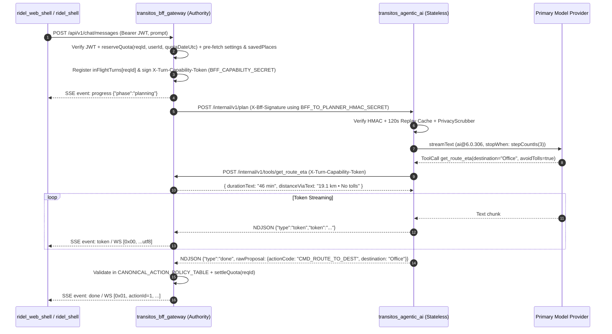

# Phase 1: Safe Agent Core (`docs/stages/01-safe-agent-core/README.md`)

**Status:** `PLANNED` (Approved for Implementation — First Vertical Slice)  
**Blueprint Revision:** `v3.1` (`2026-10-30`)  
**Related Specifications:** [Masterplan](https://www.google.com/search?q=../../architecture/TRANSITOS_AGENTIC_AI_MASTERPLAN.md) | [Tool Contracts](https://www.google.com/search?q=../../architecture/TRANSITOS_AGENTIC_AI_TOOL_CONTRACTS.md) | [Threat Model](https://www.google.com/search?q=../../architecture/TRANSITOS_AGENTIC_AI_THREAT_MODEL.md) | [Runbook](https://www.google.com/search?q=../../IMPLEMENTATION_RUNBOOK.md)

## 1. Phase Overview
Phase 1 delivers the foundational end-to-end vertical slice of `transitos_agentic_ai`: a stateless, zero-database-credential reasoning service communicating with `transitos_bff_gateway` over a split-key HMAC-authenticated internal boundary, executing bounded read-only transit tools (`get_route_eta`, `get_weather_forecast`, `list_user_saved_places`), and streaming incremental SSE tokens (`event: token`) and BFF-validated action proposals (`event: done` / `0x01` binary frames) to `ridel_web_shell` and `ridel_shell`.

## 2. Objectives
1. Establish the unforgeable split-key authentication boundary (`BFF_TO_PLANNER_HMAC_SECRET` vs. BFF-only `BFF_CAPABILITY_SECRET`) between `transitos_bff_gateway` and `transitos_agentic_ai`.
2. Enforce server-authoritative action security via `CANONICAL_ACTION_POLICY_TABLE` (`0..25`) in `transitos_bff_gateway` so the model never decides `actionId`, `securityLevel`, `requiresConfirmation`, or `confirmationToken`.
3. Implement request-bound, midnight-safe quota reservation and settlement (`InMemoryJournaledQuotaLedger`) in `transitos_bff_gateway`.
4. Stream real-time natural-language tokens and validated Level 1 route proposals (`CMD_ROUTE_TO_DEST`, `CMD_MAP_INTERACTION`, `CMD_GET_DIRECTIONS`, `CMD_EXPLORE_AI`) end-to-end using [Vercel AI SDK (ai@^6.0.306)](https://www.google.com/search?q=https://github.com/vercel/ai) (`stopWhen: stepCountIs(3)`).

## 3. Scope
* Hardening `transitos_bff_gateway` (`turn_capability.js`, `action_policy.js`, `privacy_scrubber.js`, `quota_ledger.js`, incremental SSE pipe, and `0x00`/`0x01` binary WebSocket bridge).
* Scaffolding `transitos_agentic_ai` (`env_guard.ts`, `service_auth.ts`, `pii_redactor.ts`, `action_plan_schema.ts`, `phase1_transit_tools.ts`, `stream_orchestrator.ts`).
* Integrating one primary commercial LLM provider (`@ai-sdk/google` or `@ai-sdk/openai`) with verified privacy settings (`store: false` / paid logging disabled) plus a deterministic mock provider for offline CI.

## 4. Non-Goals
* Multi-replica BFF or Planner deployments (Phase 1 is explicitly single-instance; multi-replica Postgres state arrives in Phase 2).
* Long-term semantic memory (`pgvector`), Level 2/3 action execution (`ConfirmationVault`), external web search/crawling, or PDF/image extraction.
* Adopting `@modelcontextprotocol/sdk` (deferred to Phase 4/5 out-of-process sidecars).

## 5. Prerequisites
* Node.js runtime (`>=18.20.0` for local container execution; `Node 24 LTS` enforced in release CI via `STRICT_NODE_24_GATE=1` per `ADR-AI-013`).
* Two distinct 32-byte high-entropy secrets: `BFF_TO_PLANNER_HMAC_SECRET` and `BFF_CAPABILITY_SECRET`.
* One paid-tier provider credential (`GEMINI_API_KEY` + `GEMINI_PRIVACY_ATTESTATION=PAID_LOGGING_DISABLED` or `OPENAI_API_KEY` + `OPENAI_PRIVACY_ATTESTATION=STORE_FALSE_VERIFIED`).

## 6. Existing System Dependencies
* **`transitos_bff_gateway` (`IMPLEMENTED`):** `src/server.js`, `src/security/auth_guard.js`, `src/services/storage_engine.js`, and `src/services/ai_planner_client.js` (`4/4` tests currently pass).
* **`ridel_web_shell` (`IMPLEMENTED`):** `src/features/chat_session_controller.ts` (`parseSseChatResponse`) and `src/actions/action_dispatcher.ts` (`30/30` tests currently pass).
* **`ridel_shell` (`IMPLEMENTED`):** `lib/2_ai_neural_mesh/socket_engine/binary_intent_parser.dart` and `titanium_firewall/permission_guard.dart`.

## 7. Architecture Overview


## 8. Component Responsibilities
* **`transitos_bff_gateway`:** Owns user JWT verification, `BffStorageEngine`, `InMemoryJournaledQuotaLedger`, `BFF_CAPABILITY_SECRET` signing/verification, `inFlightTurns` registry, `/internal/v1/tools/*` execution, `CANONICAL_ACTION_POLICY_TABLE` mapping, and SSE / `0x00`/`0x01` translation.
* **`transitos_agentic_ai`:** Owns `X-Bff-Signature` verification, `120s` replay cache (`max = 10,000`), `pii_redactor.ts`, bounded `streamText` orchestration (`stopWhen: stepCountIs(3)`), and NDJSON streaming. Holds **zero** database credentials and **zero** access to `BFF_CAPABILITY_SECRET`.

## 9. Data Flow
1. Client sends `POST /api/v1/chat/messages` with `Authorization: Bearer <jwt>` and `Idempotency-Key`.
2. BFF authenticates JWT (`chat:write` scope), reserves `maxTurnTokens = 13,024` in `InMemoryJournaledQuotaLedger` bound to `(requestId, userId, quotaDateUtc)`, loads `userSettings` and `savedPlacesSummary` (`<= 10`), and emits `event: progress`.
3. BFF signs `PlannerTurnRequest` with `BFF_TO_PLANNER_HMAC_SECRET` and attaches an opaque `X-Turn-Capability-Token` (`deadlineMs = now + 18,000 ms`) signed with `BFF_CAPABILITY_SECRET`.
4. Planner verifies `X-Bff-Signature`, scrubs PII, runs `streamText`, calls `/internal/v1/tools/get_route_eta` with `X-Turn-Capability-Token`, and streams NDJSON `token` and `done` lines.
5. BFF validates `rawProposal.actionCode` against `CANONICAL_ACTION_POLICY_TABLE`, settles actual token usage on `reservation.quotaDateUtc`, records the redacted audit log, and flushes `event: done`.

## 10. API and Tool Contracts
* **Internal Planner Endpoint:** `POST /internal/v1/plan` (Headers: `X-Request-Id`, `X-Timestamp`, `X-User-Id`, `X-Bff-Key-Id`, `X-Bff-Signature`; Response: `application/x-ndjson`).
* **Internal Tool Callback Endpoints on BFF:**
  * `POST /internal/v1/tools/get_route_eta` (`routing:read`, `3,000 ms` timeout, max `2/turn`).
  * `POST /internal/v1/tools/get_weather_forecast` (`routing:read`, `2,500 ms` timeout, max `1/turn`).
  * `POST /internal/v1/tools/list_user_saved_places` (`profile:read`, `1,500 ms` timeout, max `1/turn`).
* Full Zod schemas are defined in [TRANSITOS\_AGENTIC\_AI\_TOOL\_CONTRACTS.md](https://www.google.com/search?q=../../architecture/TRANSITOS_AGENTIC_AI_TOOL_CONTRACTS.md).

## 11. Database and Persistence Requirements
* **Phase 1 Storage Backend:** Uses `transitos_bff_gateway`'s existing single-instance `BffStorageEngine` (`data/`) plus `InMemoryJournaledQuotaLedger` (`data/quota_ledger.json`).
* **Planner Persistence:** Zero (`transitos_agentic_ai` is 100% stateless).

## 12. Security and Privacy Requirements
* **Split-Key Isolation (`REQ-01`, `REQ-03`):** `transitos_agentic_ai` throws a fatal startup error if `DATABASE_URL` or `BFF_CAPABILITY_SECRET` is present in its environment.
* **Fail-Closed Replay Cache (`REQ-02`):** Rejects replayed `requestId` (`409`) and fails closed (`503`) if `10,000` unexpired entries are reached.
* **Server-Authoritative Action Policy (`REQ-04`):** Any Level 2/3 or client-only action proposed in Phase 1 is deterministically downgraded to `CMD_NONE` by the BFF.
* **Provider Privacy & PII Scrubbing (`REQ-19`, `REQ-21`):** Scrubs PII before egress, sets `store: false` on OpenAI calls, and requires `*_PRIVACY_ATTESTATION` in `production`.

## 13. Technology and Open-Source Dependencies
* [ai@^6.0.306](https://www.google.com/search?q=https://www.npmjs.com/package/ai) (Apache-2.0)
* `@ai-sdk/google@^2.x` / `@ai-sdk/openai@^2.x` (Apache-2.0)
* [zod@^3.25.76](https://www.google.com/search?q=https://github.com/colinhacks/zod) (MIT — pinned to avoid `zod@4.0.0–4.0.3` issue [#7189](https://www.google.com/search?q=https://github.com/vercel/ai/issues/7189))
* [@opentelemetry/api@^1.9.0](https://www.google.com/search?q=https://github.com/open-telemetry/opentelemetry-js) (Apache-2.0)

## 14. Repository and File Structure
```text
transitos_agentic_ai/
├── package.json
├── tsconfig.json
├── scripts/
│   └── typecheck.js
├── src/
│   ├── server.ts
│   ├── config/env_guard.ts
│   ├── contracts/action_plan_schema.ts
│   ├── security/
│   │   ├── service_auth.ts
│   │   └── pii_redactor.ts
│   ├── tools/phase1_transit_tools.ts
│   └── orchestrator/stream_orchestrator.ts
└── tests/
    ├── env_guard.test.ts
    ├── service_auth.test.ts
    ├── stream_orchestrator.test.ts
    └── e2e_phase1_vertical_slice.test.ts
```

## 15. Step-by-Step Implementation Sequence
1. **`TASK-1.1` (Split-Key Auth & Turn Capability Signer — Owner: `transitos_bff_gateway`):**
   - *What & Why:* Build `src/security/turn_capability.js` so only the BFF can mint/verify `X-Turn-Capability-Token` (`BFF_CAPABILITY_SECRET`) while signing `/internal/v1/plan` with `BFF_TO_PLANNER_HMAC_SECRET`.
   - *Prerequisites & Contracts:* Existing `auth_guard.js`; `TOOL_CONTRACTS.md` §1.
   - *How to Implement & Test:* Use `crypto.createHmac('sha256', ...)` and `crypto.timingSafeEqual`. Run `node --test tests/turn_capability.test.js`.
   - *Completion Proof:* Forged token signed with `BFF_TO_PLANNER_HMAC_SECRET` returns `401`.
2. **`TASK-1.2` (Canonical Action Policy, Privacy Scrubber & Quota Ledger — Owner: `transitos_bff_gateway`):**
   - *What & Why:* Build `action_policy.js` (`CANONICAL_ACTION_POLICY_TABLE`), `privacy_scrubber.js`, and `quota_ledger.js` (`InMemoryJournaledQuotaLedger` bound to `quotaDateUtc` at reservation time).
   - *Prerequisites & Contracts:* `TASK-1.1`; `TOOL_CONTRACTS.md` §2.2 & `EVALUATION_PLAN.md` §1.
   - *How to Implement & Test:* Run `node --test tests/action_policy_and_quota.test.js`.
   - *Completion Proof:* Spoofed `CMD_LOGOUT` downgraded; 10-way concurrent burst and midnight UTC boundary tests pass.
3. **`TASK-1.3` (BFF `AiPlannerClient` Streaming Upgrade & Tool Callback Routes — Owner: `transitos_bff_gateway`):**
   - *What & Why:* Expose `/internal/v1/tools/get_route_eta`, `get_weather_forecast`, and `list_user_saved_places`; pipe NDJSON `progress`/`token`/`done` frames to SSE and `0x00`/`0x01` WS; propagate `req.on('close')` -> `AbortController.abort()`.
   - *Prerequisites & Contracts:* `TASK-1.1`, `TASK-1.2`.
   - *How to Test & Completion Proof:* `node --test tests/bff_gateway.test.js` passes 100%.
4. **`TASK-1.4` (`transitos_agentic_ai` Scaffold & `env_guard.ts` — Owner: `transitos_agentic_ai`):**
   - *What & Why:* Initialize `package.json` (`ai@^6.0.306`, `zod@^3.25.76`) and `env_guard.ts` rejecting `DATABASE_URL` or `BFF_CAPABILITY_SECRET`.
   - *Completion Proof:* `node --test tests/env_guard.test.ts` passes (`REQ-01`, `REQ-21`, `REQ-22`).
5. **`TASK-1.5` (Planner `service_auth.ts`, Replay Cache & Zod Schemas — Owner: `transitos_agentic_ai`):**
   - *What & Why:* Verify `X-Bff-Signature` and enforce the `120s` / `10,000`-entry fail-closed replay cache.
   - *Completion Proof:* `node --test tests/service_auth.test.ts` passes (`REQ-02`).
6. **`TASK-1.6` (Phase 1 Tool Wrappers & `StreamOrchestrator` — Owner: `transitos_agentic_ai`):**
   - *What & Why:* Implement `streamText` with `stopWhen: stepCountIs(3)` and NDJSON output streaming.
   - *Completion Proof:* `node --test tests/stream_orchestrator.test.ts` passes (`REQ-14`, `REQ-15`).
7. **`TASK-1.7` (Cross-Repo E2E Integration & CI Security Scan — Owner: Both Repos):**
   - *What & Why:* Verify `ridel_web_shell` SSE and `ridel_shell` `0x00`/`0x01` frames against live local BFF + Planner.
   - *Completion Proof:* All tests pass across `transitos_agentic_ai`, `transitos_bff_gateway`, and `ridel_web_shell`.

## 16. Testing Strategy
* **Unit Tests (Offline, `< 5s`):** `env_guard`, `service_auth`, `turn_capability`, `action_policy`, `quota_ledger`, `privacy_scrubber`.
* **Integration Tests (Offline Mock LLM, `< 10s`):** Full BFF <-> Planner <-> Tool Callback <-> SSE / `0x01` lifecycle, replay rejection (`409`), disconnect cancellation (`< 50 ms`), and midnight quota settlement.

## 17. Performance and Cost Considerations
* **Pre-Hydrated Context (`ADR-AI-006`):** Injecting `userSettings` and `savedPlacesSummary` (`<= 10`) into `PlannerTurnRequest` eliminates an extra LLM tool call on *"Route me to Office"* queries, keeping `TTFT p95 <= 900 ms` (single-pass) and `Full Turn p95 <= 3,500 ms` (with `get_route_eta`).
* **Token Ceilings:** `maxInputTokens = 12,000`, `maxOutputTokens = 1,024` (`mean cost <= $0.0025/turn`).

## 18. Error Handling and Recovery
* **Planner Unreachable / Timeout:** BFF aborts at `8,000 ms` idle (`15,000 ms` total), refunds 100% of reserved quota (`tokensEmitted === 0`), and returns `HTTP 503` (while deterministic map/search routes stay 100% available).
* **Mid-Stream Failure (`tokensEmitted > 0`):** Emits `event: error` (`{"code":"STREAM_INTERRUPTED","retryable":true}`) and settles consumed tokens without splicing a second provider.

## 19. Observability
* Emits OpenTelemetry spans (`gen_ai.request.model`, `gen_ai.usage.input_tokens`, `gen_ai.usage.output_tokens`, `transitos.ttft_ms`, `transitos.tool_calls_count`) correlated by `X-Request-Id`.
* Writes privacy-scrubbed summary records (`user_id_hash` only; `0` prompts or arguments) to `ai_audit_logs`.

## 20. Deployment and Rollback
* **Deployment:** Run as a single-instance stateless Node.js process (`PORT=4100` on internal loopback/VPC) alongside `transitos_bff_gateway` (`PORT=4000`).
* **Rollback:** Unset `LLM_PROVIDER_URL` on `transitos_bff_gateway` or revert to the previous container image; zero database schema rollback is required because Phase 1 introduces no SQL DDL changes.

## 21. Acceptance Criteria
1. `REQ-01`..`REQ-04`, `REQ-14`..`REQ-16`, `REQ-18`, `REQ-19`, `REQ-21`, `REQ-22` tests pass with `0` failures.
2. *"Route me to Office avoiding tolls"* streams live SSE tokens to `ridel_web_shell` and renders the `46 min` / `19.1 km • No tolls` Route Card (`CMD_ROUTE_TO_DEST`).
3. Native `0x00` and `0x01` binary frames decode cleanly in `BinaryIntentParser` with zero `jsonDecode()`.

## 22. Completion Checklist
- [ ] `TASK-1.1`: Split-key `turn_capability.js` implemented and tested.
- [ ] `TASK-1.2`: `CANONICAL_ACTION_POLICY_TABLE`, `privacy_scrubber.js`, and `InMemoryJournaledQuotaLedger` implemented and tested.
- [ ] `TASK-1.3`: BFF `/internal/v1/tools/*` and incremental SSE/WS streaming wired.
- [ ] `TASK-1.4`: `transitos_agentic_ai` scaffolded with `env_guard.ts`.
- [ ] `TASK-1.5`: `service_auth.ts` and fail-closed replay cache implemented.
- [ ] `TASK-1.6`: `stream_orchestrator.ts` (`ai@^6.0.306`, `stopWhen: stepCountIs(3)`) implemented.
- [ ] `TASK-1.7`: Cross-repo E2E tests and OSV/Trivy scans passing.

## 23. Known Risks and Open Questions
* **Single-Instance Constraint in Phase 1:** `InMemoryJournaledQuotaLedger` and the in-memory `120s` replay cache only protect a single BFF/Planner replica. Do **not** scale to `> 1` replica until Phase 2 (`PostgresQuotaLedger` + `internal_request_nonces`) is deployed.

## 24. Handoff to the Next Phase
Once all Phase 1 Completion Checklist items are checked and verified, proceed to **[Phase 2: Persistent Memory \& Retrieval (../02-persistent-memory/README.md)](https://www.google.com/search?q=../02-persistent-memory/README.md)** to provision PostgreSQL 16 + `pgvector`, enable 12-table `FORCE ROW LEVEL SECURITY`, and wire `ConfirmationVault` (`POST /api/v1/actions/confirm`).
