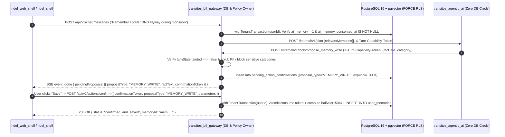

# Phase 2: Persistent Memory and Retrieval (`docs/stages/02-persistent-memory/README.md`)

**Status:** `PLANNED` (Gated on Phase 1 Completion)  
**Blueprint Revision:** `v3.1` (`2026-10-30`)  
**Related Specifications:** [Memory Design](https://www.google.com/search?q=../../architecture/TRANSITOS_AGENTIC_AI_MEMORY_DESIGN.md) | [Tool Contracts](https://www.google.com/search?q=../../architecture/TRANSITOS_AGENTIC_AI_TOOL_CONTRACTS.md) | [Threat Model](https://www.google.com/search?q=../../architecture/TRANSITOS_AGENTIC_AI_THREAT_MODEL.md) | [Runbook](https://www.google.com/search?q=../../IMPLEMENTATION_RUNBOOK.md)

## 1. Phase Overview
Phase 2 upgrades `transitos_bff_gateway` from its single-instance in-memory/file store to a multi-replica-ready **PostgreSQL 16+ database with [pgvector](https://www.google.com/search?q=https://github.com/pgvector/pgvector) and `pg_trgm`**, enforcing **13-table access control (`FORCE ROW LEVEL SECURITY` on all 10 tenant tables under a `NOBYPASSRLS` role)**, explicit opt-in memory consent (`ai_memory_consented_at`), the single-use **`ConfirmationVault` (`POST /api/v1/actions/confirm`)**, multilingual hybrid RRF memory retrieval, and transactional account-deletion blob cleanup (`deleted_blob_cleanup_queue`).

## 2. Objectives
1. Enforce tenant isolation at the database layer via `ENABLE` + `FORCE ROW LEVEL SECURITY` across all 10 tenant tables from Migrations `001` and `002` under `transitos_app_runtime` (`NOSUPERUSER NOBYPASSRLS`).
2. Ensure zero silent legacy opt-in by adding `ai_memory_consented_at TIMESTAMPTZ DEFAULT NULL` and resetting unconsented `user_settings.ai_memory` rows to `0`.
3. Implement `ConfirmationVault` (`POST /api/v1/actions/confirm`) with RFC 8785 JCS `params_sha256` binding so Level 2/3 UI actions (`UI_ACTION`), memory writes (`MEMORY_WRITE`), and saved-place upserts (`SAVED_PLACE_UPSERT`) execute only after explicit user confirmation.
4. Deliver sub-15ms hybrid memory retrieval (`halfvec(1536)` HNSW cosine distance + `to_tsvector('simple', ...)` + `pg_trgm`) and crash-safe account deletion (`deleted_blob_cleanup_queue` + `deleted_accounts_tombstone`).

## 3. Scope
* Applying `migrations/002_agentic_memory.up.sql` and `.down.sql` in `transitos_bff_gateway`.
* Implementing `withTenantTransaction` (`SELECT set_config('app.current_user_id', $1, true)`), `PostgresQuotaLedger` (`ai_quota_ledger` + `ai_quota_reservations`), and `internal_request_nonces` in `transitos_bff_gateway`.
* Implementing `ConfirmationVault` (`POST /api/v1/actions/confirm`) and `/api/v1/memories/*` CRUD/export/wipe routes in `transitos_bff_gateway`.
* Adding `search_user_memory`, `propose_memory_write`, and `propose_saved_place_upsert` tool wrappers in `transitos_agentic_ai`.
* Updating `parseSseChatResponse()` in `ridel_web_shell` to preserve `pendingProposals` and `citations` (`CDR-027`).

## 4. Non-Goals
* External vector or graph databases (Qdrant, Pinecone, Milvus, Neo4j, FalkorDB).
* Implicit background LLM memory extraction on every turn (Mem0/Graphiti style) without user approval.
* Giving `transitos_agentic_ai` direct PostgreSQL credentials (`transitos_agentic_ai` remains 100% database-credential-free).

## 5. Prerequisites
* All Phase 1 Acceptance Criteria and Completion Checklist items verified (`PASS`).
* PostgreSQL 16+ instance provisioned with `vector` (`pgvector 0.7+`) and `pg_trgm` extensions installed.
* Embedding API endpoint configured on `transitos_bff_gateway` (`EMBEDDING_MODEL_ID=text-embedding-3-small-1536` or Gemini embedding model producing 1536-dim vectors).

## 6. Existing System Dependencies
* `transitos_bff_gateway/migrations/001_initial_bff_schema.up.sql` (`IMPLEMENTED`).
* `transitos_bff_gateway/src/services/storage_engine.js` (`IMPLEMENTED`).
* `ridel_web_shell/src/features/chat_session_controller.ts` & `src/components/profile_sheet.ts` (`IMPLEMENTED`).

## 7. Architecture Overview


## 8. Component Responsibilities
* **`transitos_bff_gateway`:** Owns the PostgreSQL connection pool (`transitos_app_runtime`), `withTenantTransaction`, `PgMemoryStore`, `PostgresQuotaLedger`, `ConfirmationVault`, `deleted_blob_cleanup_queue` sweeper, and `/api/v1/memories/*` endpoints.
* **`transitos_agentic_ai`:** Invokes `search_user_memory`, `propose_memory_write`, and `propose_saved_place_upsert` over internal HTTP callbacks to the BFF using `X-Turn-Capability-Token`.
* **`ridel_web_shell`:** Renders `pendingProposals` confirmation chips in chat and memory management controls (`View`, `Export`, `Delete`, `Toggle Memory`) in Settings/Profile.

## 9. Data Flow
1. **Consent Activation:** User enables `Memory` in Settings (`PUT /api/v1/settings` `{ aiMemory: true }`) -> BFF sets `ai_memory = 1, ai_memory_consented_at = NOW()`.
2. **Pre-Turn Retrieval:** On `POST /api/v1/chat/messages`, if `ai_memory == 1`, BFF embeds `prompt` and executes the hybrid RRF SQL query (`MEMORY_DESIGN.md` §4) inside `withTenantTransaction(pool, userId)`, passing the top 5 matches in `PlannerTurnRequest.relevantMemories`.
3. **Memory Proposal:** When the user states a durable preference on an untainted turn, the planner calls `/internal/v1/tools/propose_memory_write`. BFF creates a `MEMORY_WRITE` row in `pending_action_confirmations` (`300s` TTL) and returns `confirmationToken`.
4. **User Confirmation & Contradiction Upsert:** When the user confirms via `POST /api/v1/actions/confirm`, BFF redeems the token once, checks if an existing memory in the same `category` has cosine similarity `>= 0.85` (updating it in-place if so, or inserting a new row if not), and returns the saved `memoryId`.

## 10. API and Tool Contracts
* **Public BFF Endpoints:**
  * `POST /api/v1/actions/confirm`: Redeems single-use `confirmationToken` for `UI_ACTION`, `MEMORY_WRITE`, or `SAVED_PLACE_UPSERT` (`TOOL_CONTRACTS.md` §2.3).
  * `GET /api/v1/memories`: Lists active memories for `jwt.sub`.
  * `GET /api/v1/memories/export`: Exports all user memories as JSON (`application/json`).
  * `PUT /api/v1/memories/:memoryId` & `DELETE /api/v1/memories/:memoryId` (plus `DELETE /api/v1/memories?all=true`).
* **Internal BFF Tool Endpoints:**
  * `POST /internal/v1/tools/search_user_memory`
  * `POST /internal/v1/tools/propose_memory_write`
  * `POST /internal/v1/tools/propose_saved_place_upsert`

## 11. Database and Persistence Requirements
* Complete SQL DDL is specified in [TRANSITOS\_AGENTIC\_AI\_MEMORY\_DESIGN.md §3](https://www.google.com/search?q=../../architecture/TRANSITOS_AGENTIC_AI_MEMORY_DESIGN.md).
* Enforces `ENABLE` + `FORCE ROW LEVEL SECURITY` across all 10 tenant tables (`user_profiles`, `user_settings`, `saved_places`, `attachments`, `chat_messages`, `chat_thread_summaries`, `user_memories`, `user_attachment_chunks`, `pending_action_confirmations`, `ai_quota_ledger`, `ai_quota_reservations`).
* Enforces composite foreign key `FOREIGN KEY (attachment_id, owner_id) REFERENCES attachments(attachment_id, owner_id) ON DELETE CASCADE` on `user_attachment_chunks` and `(owner_id, quota_date_utc)` on `ai_quota_reservations`.

## 12. Security and Privacy Requirements
* **Least-Privilege Runtime Role (`REQ-06`):** `transitos_app_runtime` has `NOSUPERUSER NOBYPASSRLS NOCREATEDB NOCREATEROLE`. BFF startup health check queries `pg_roles` and `pg_class` and refuses to boot if `rolbypassrls == true` or any tenant table lacks `relforcerowsecurity == true`.
* **Transaction-Scoped Context (`REQ-06`):** `withTenantTransaction` always executes `SELECT set_config('app.current_user_id', $1, true)` inside `BEGIN ... COMMIT` so pooled connections never bleed tenant context.
* **Sensitive Category Prohibition (`REQ-19`):** `propose_memory_write` rejects facts containing health/medical data, religion, caste, political beliefs, sexual orientation, government IDs, financial credentials, or biometrics.
* **Crash-Safe Deletion Outbox (`REQ-20`, `CDR-026`):** `DELETE /api/v1/account` records attachment paths in `deleted_blob_cleanup_queue` inside the SQL transaction before cascading deletes, retrying any failed file unlinks post-commit.

## 13. Technology and Open-Source Dependencies
* `pg@^8.13.0` (MIT — PostgreSQL client for `transitos_bff_gateway` only)
* [pgvector@^0.2.0](https://www.google.com/search?q=https://github.com/pgvector/pgvector) (MIT — SQL helper for `halfvec(1536)` formatting)
* PostgreSQL 16+ server extensions: `vector` and `pg_trgm`

## 14. Repository and File Structure
```text
transitos_bff_gateway/
├── migrations/
│   ├── 001_initial_bff_schema.up.sql
│   ├── 002_agentic_memory.up.sql
│   └── 002_agentic_memory.down.sql
├── src/
│   ├── services/
│   │   ├── pg_tenant_pool.js
│   │   ├── pg_memory_store.js
│   │   ├── confirmation_vault.js
│   │   └── blob_cleanup_sweeper.js
└── tests/
    ├── pg_rls_isolation.test.js
    ├── confirmation_vault.test.js
    └── pg_memory_and_deletion.test.js
```

## 15. Step-by-Step Implementation Sequence
1. **`TASK-2.1` (Migration `002_agentic_memory.up.sql` & Role Verification — Owner: `transitos_bff_gateway`):**
   - *What & Why:* Author `002_agentic_memory.up.sql` & `.down.sql` enabling `FORCE RLS` on all 10 tenant tables, resetting legacy unconsented `ai_memory` rows to `0`, and creating `deleted_blob_cleanup_queue`.
   - *How to Test & Completion Proof:* `npm run migrate:up && node --test tests/pg_rls_isolation.test.js` verifies `relforcerowsecurity = true`, blocks cross-tenant `INSERT` (`SQLSTATE 42501`), and blocks cross-tenant chunk FK (`SQLSTATE 23503`).
2. **`TASK-2.2` (`withTenantTransaction`, `PostgresQuotaLedger` & Multi-Replica Nonce Store — Owner: `transitos_bff_gateway`):**
   - *What & Why:* Implement transaction-scoped tenant pooling, SQL quota reservation/settlement (`ai_quota_reservations`), and `internal_request_nonces`.
   - *Completion Proof:* `node --test tests/pg_quota_and_pool.test.js` passes 100-concurrency pool test with `0` leaks.
3. **`TASK-2.3` (`ConfirmationVault` & `POST /api/v1/actions/confirm` — Owner: `transitos_bff_gateway`):**
   - *What & Why:* Implement RFC 8785 JCS parameter hashing and atomic single-use token redemption for `UI_ACTION`, `MEMORY_WRITE`, and `SAVED_PLACE_UPSERT`.
   - *Completion Proof:* `node --test tests/confirmation_vault.test.js` passes (`REQ-05`).
4. **`TASK-2.4` (`PgMemoryStore`, `/api/v1/memories/*` & Outbox Sweeper — Owner: `transitos_bff_gateway` & `transitos_agentic_ai`):**
   - *What & Why:* Implement hybrid RRF search (`simple` + `pg_trgm` + `pgvector`), memory CRUD/export/wipe routes, and `deleted_blob_cleanup_queue` retry sweeper.
   - *Completion Proof:* `node --test tests/pg_memory_and_deletion.test.js` passes (`recall@5 >= 0.90`, outbox recovers simulated `EIO`).
5. **`TASK-2.5` (Web Shell `parseSseChatResponse` Pass-Through — Owner: `ridel_web_shell`):**
   - *What & Why:* Preserve `pendingProposals` and `citations` in `parseSseChatResponse()` (`CDR-027`).
   - *Completion Proof:* `cd ridel_web_shell && npm test` passes all suites.

## 16. Testing Strategy
* **Database RLS & Constraint Suite:** Runs against a real PostgreSQL 16 + `pgvector` container under `transitos_app_runtime` (`NOBYPASSRLS`).
* **Concurrency & Pool Bleed Suite:** 100 interleaved User A / User B transactions on a 4-connection pool.
* **Confirmation & Outbox Fault-Injection Suite:** Replayed/expired/tampered confirmation tokens and simulated `EIO` disk unlink failures during account deletion.

## 17. Performance and Cost Considerations
* **HNSW & Trigram Indexing:** `halfvec(1536)` uses 50% less RAM than `vector(1536)` with `> 0.98` recall; hybrid RRF query executes in **`p95 <= 15 ms`** at 10,000 rows per user.
* **Zero Background LLM Calls on ReadTurns:** Unlike Mem0/Graphiti, memory writes are proposed inline by the planner only when the user states a preference, adding `$0` background LLM overhead on ordinary turns.

## 18. Error Handling and Recovery
* **Memory DB Timeout (`> 1,500 ms`):** If pre-turn memory hydration times out, BFF logs a warning and proceeds with stateless turn planning (`relevantMemories: []`).
* **Quota / Confirmation DB Outage:** Fails closed (`HTTP 503`) before executing paid LLM calls or high-risk confirmations.

## 19. Observability
* Records `transitos.memory.retrieval_latency_ms`, `transitos.memory.matches_count`, `transitos.confirmation.redeemed_total`, and `transitos.blob_outbox.pending_count` in OpenTelemetry metrics.

## 20. Deployment and Rollback
* **Deployment:** Run `npm run migrate:up` using `transitos_migrations_admin` credentials, then start `transitos_bff_gateway` using `transitos_app_runtime` credentials.
* **Rollback:** Run `npm run migrate:down` (`002_agentic_memory.down.sql`) to cleanly drop Phase 2 tables and policies while preserving Migration `001` tables.

## 21. Acceptance Criteria
1. `REQ-05` through `REQ-09`, `REQ-18` (Postgres), and `REQ-20` tests pass with `0` failures.
2. Hybrid memory search achieves **`recall@5 >= 0.90`** and **`p95 <= 15 ms`** on the golden multilingual dataset (`"Hauz Khas"`, `"NH-48"`, `"DND"`, `"T3"`).
3. `DELETE /api/v1/account` wipes all 10 tenant tables, clears all attachment blobs via `deleted_blob_cleanup_queue`, and writes `deleted_accounts_tombstone`.

## 22. Completion Checklist
- [ ] `TASK-2.1`: Migration `002_agentic_memory.up.sql` applied and 12-table RLS verified.
- [ ] `TASK-2.2`: `withTenantTransaction`, `PostgresQuotaLedger`, and `internal_request_nonces` verified.
- [ ] `TASK-2.3`: `ConfirmationVault` (`POST /api/v1/actions/confirm`) verified.
- [ ] `TASK-2.4`: `PgMemoryStore`, `/api/v1/memories/*`, and `deleted_blob_cleanup_queue` verified.
- [ ] `TASK-2.5`: `ridel_web_shell` `parseSseChatResponse` updated and verified.

## 23. Known Risks and Open Questions
* **Embedding Model Upgrades:** If the embedding model is changed in a future release, old rows with the previous `embedding_model` tag remain excluded from cosine comparisons until re-embedded by a background migration job.

## 24. Handoff to the Next Phase
Once all Phase 2 gates pass, proceed to **[Phase 3: Web Research \& Grounded Answers (../03-web-research/README.md)](https://www.google.com/search?q=../03-web-research/README.md)** to add `acquire_research_lease`, `SafeWebFetcher`, `worker_threads` extraction, and `CitationValidator`.
