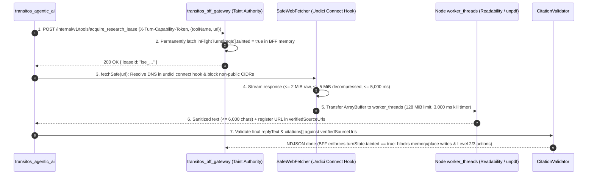

# Phase 3: Web Research and Grounded Answers (`docs/stages/03-web-research/README.md`)

**Status:** `PLANNED` (Gated on Phase 2 Completion)  
**Blueprint Revision:** `v3.1` (`2026-10-30`)  
**Related Specifications:** [Browsing \& Crawling Design](https://www.google.com/search?q=../../architecture/TRANSITOS_AGENTIC_AI_BROWSING_AND_CRAWLING_DESIGN.md) | [Threat Model](https://www.google.com/search?q=../../architecture/TRANSITOS_AGENTIC_AI_THREAT_MODEL.md) | [Tool Contracts](https://www.google.com/search?q=../../architecture/TRANSITOS_AGENTIC_AI_TOOL_CONTRACTS.md) | [Runbook](https://www.google.com/search?q=../../IMPLEMENTATION_RUNBOOK.md)

## 1. Phase Overview
Phase 3 equips `transitos_agentic_ai` with live transit web search (`web_search_transit`), SSRF-hardened webpage/PDF fetching (`fetch_and_extract_webpage`), preemptible `worker_threads` content extraction ([@mozilla/readability](https://www.google.com/search?q=https://github.com/mozilla/readability) for HTML and [unpdf](https://www.google.com/search?q=https://github.com/unjs/unpdf) for PDFs), **BFF-authoritative taint latching (`acquire_research_lease`)**, and deterministic citation provenance verification (`CitationValidator`).

## 2. Objectives
1. Ensure `transitos_bff_gateway` authoritatively latches `inFlightTurns.get(reqId).tainted = true` via `POST /internal/v1/tools/acquire_research_lease` before any external web search or fetch executes (`ADR-AI-011 v3.0`).
2. Eliminate SSRF, DNS rebinding, and decompression bombs via connect-time DNS IP pinning in `undici.Agent`, dual stream caps (`<= 2 MiB` raw / `<= 5 MiB` decompressed), and Linux kernel `nftables` egress rules.
3. Isolate synchronous CPU-bound HTML (`@mozilla/readability`) and PDF (`unpdf`) parsing inside a bounded Node.js `worker_threads` pool (`128 MiB` heap cap, `worker.terminate()` at `3,000 ms`) so hostile pages never stall active SSE streams (`ADR-AI-007 v3.0`).
4. Guarantee `0` hallucinated URLs by validating every emitted citation against the turn's verified tool-output URL set (`CitationValidator`).

## 3. Scope
* Implementing `POST /internal/v1/tools/acquire_research_lease` and taint-based capability downgrade in `transitos_bff_gateway`.
* Implementing `SearchProviderAdapter` (Brave Search / Tavily REST API), `SafeWebFetcher` (`undici` connect-time DNS pinning + dual stream byte caps), `extractor_worker.ts` (`worker_threads` + `@mozilla/readability` + `unpdf`), and `CitationValidator` in `transitos_agentic_ai`.
* Deploying `ops/nftables_ai_egress.nft` container/host firewall rules.

## 4. Non-Goals
* Running headless Chromium (`Playwright`) inside the core planner process (deferred to Phase 5 optional isolated container).
* Unbounded open-web spidering or bypassing `robots.txt` / paywalls / CAPTCHAs.

## 5. Prerequisites
* All Phase 2 Acceptance Criteria and Completion Checklist items verified (`PASS`).
* Commercial search API credential (`BRAVE_SEARCH_API_KEY` or `TAVILY_API_KEY`) provisioned in `transitos_agentic_ai`.

## 6. Existing System Dependencies
* `transitos_bff_gateway` `inFlightTurns` registry and `action_policy.js` (`Phase 1–2`).
* `ridel_web_shell` `parseSseChatResponse()` (`citations` pass-through added in `TASK-2.5`).

## 7. Architecture Overview


## 8. Component Responsibilities
* **`transitos_bff_gateway`:** Owns `POST /internal/v1/tools/acquire_research_lease`, latches `inFlightTurns.get(reqId).tainted = true`, hard-blocks `propose_memory_write` and `propose_saved_place_upsert` on tainted turns (`HTTP 403`), and downgrades any Level 2/3 `rawProposal` to `CMD_NONE`.
* **`SafeWebFetcher` (`transitos_agentic_ai`):** Enforces scheme/port checks (`https:` 443 / `http:` 80), connect-time DNS IP validation, manual redirect re-validation (`maxRedirects = 3`), and dual byte limits (`2 MiB` raw / `5 MiB` decompressed).
* **`extractor_worker.ts` (`transitos_agentic_ai`):** Runs in `worker_threads` (`maxWorkers = 2`, `128 MiB` heap), loads `core-js/actual/iterator` polyfill on Node `<22`, and dispatches HTML to `@mozilla/readability` and `%PDF-` to `unpdf` (`maxPages = 10`, `maxImageSize = 16 MP`).
* **`CitationValidator` (`transitos_agentic_ai`):** Strips any URL from `citations[]` and `replyText` not present in the turn's `verifiedSourceUrls` map.

## 9. Data Flow
1. Planner determines live transit search or page extraction is needed and calls `POST /internal/v1/tools/acquire_research_lease` on the BFF.
2. BFF marks `inFlightTurns.get(reqId).tainted = true` and returns a lease ID.
3. `SearchProviderAdapter` scrubs PII from the query and calls Brave/Tavily (`<= 4,000 ms`), registering returned URLs in `verifiedSourceUrls`.
4. If deeper page extraction is needed, `SafeWebFetcher` connects to the verified public IP, streams up to `2 MiB` compressed / `5 MiB` decompressed bytes, and transfers the buffer to `extractor_worker.ts`.
5. Extracted plain text (`<= 6,000` chars) is wrapped in `<untrusted_external_data source_url="...">...</untrusted_external_data>`.
6. Before emitting `done`, `CitationValidator` verifies all citations against `verifiedSourceUrls`, and BFF enforces the taint downgrade.

## 10. API and Tool Contracts
* **BFF Internal Endpoint:** `POST /internal/v1/tools/acquire_research_lease` (Input: `{ toolName: 'web_search_transit' | 'fetch_and_extract_webpage', target: string }`; Output: `{ leaseId: string, tainted: true }`).
* **Planner Tools:**
  * `web_search_transit`: `{ query: string.max(200), freshness?: 'day'|'week'|'month' }` -> returns up to 5 `CitationSource` items.
  * `fetch_and_extract_webpage`: `{ url: string.url().startsWith('https://') }` -> returns `{ url, title, contentMarkdown, contentSha256, retrievedAt }`.

## 11. Database and Persistence Requirements
* Taint state (`inFlightTurns.get(reqId).tainted`) is held in BFF memory during the active turn and persisted to `ai_audit_logs.tainted_by_external_content` (`BOOLEAN`) and `chat_messages.tainted_source` at turn completion.

## 12. Security and Privacy Requirements
* **BFF Taint Authority (`REQ-10`, `CDR-021`):** Even if the planner omits `taintedByExternalContent` or sends `false`, the BFF's `inFlightTurns.get(reqId).tainted` latch remains `true` and blocks all memory/place writes and Level 2/3 actions.
* **Pre-Socket SSRF & Decompression Defense (`REQ-11`):** Blocks `0.0.0.0/8`, `10.0.0.0/8`, `100.64.0.0/10`, `127.0.0.0/8`, `169.254.0.0/16`, `172.16.0.0/12`, `192.168.0.0/16`, `224.0.0.0/4`, `240.0.0.0/4`, `::1`, `fc00::/7`, `fe80::/10`, `::ffff:0:0/96`, and `64:ff9b::/96` inside the `undici` `connect` hook, backed by `ops/nftables_ai_egress.nft`.
* **Worker Preemption (`REQ-12`, `CDR-022`):** Calls `await worker.terminate()` if HTML/PDF extraction exceeds `3,000 ms`.

## 13. Technology and Open-Source Dependencies
* `undici@^6.21.0` (MIT — custom `Agent` connect hook)
* [@mozilla/readability@^0.5.0](https://www.google.com/search?q=https://github.com/mozilla/readability) (Apache-2.0) + `linkedom@^0.18.5` (ISC)
* [unpdf@^1.0.0](https://www.google.com/search?q=https://github.com/unjs/unpdf) (MIT, bundling Apache-2.0 `pdf.js` v6.4.299) + `core-js@^3.38.0` (`core-js/actual/iterator` polyfill for Node `<22`)

## 14. Repository and File Structure
```text
transitos_agentic_ai/
├── ops/
│   └── nftables_ai_egress.nft
├── src/
│   ├── contracts/citation_validator.ts
│   ├── research/
│   │   ├── safe_fetcher.ts
│   │   └── search_adapter.ts
│   └── workers/
│       └── extractor_worker.ts
└── tests/
    ├── taint_enforcement.test.js
    ├── safe_fetcher_ssrf.test.ts
    ├── extractor_worker.test.ts
    └── citation_validator.test.ts
```

## 15. Step-by-Step Implementation Sequence
1. **`TASK-3.1` (BFF `acquire_research_lease` & Taint Latch — Owner: `transitos_bff_gateway`):**
   - *What & Why:* Add `/internal/v1/tools/acquire_research_lease` to latch `inFlightTurns[reqId].tainted = true` in BFF memory and block memory/place writes and Level 2/3 actions.
   - *Completion Proof:* `node --test tests/taint_enforcement.test.js` passes (`REQ-10`).
2. **`TASK-3.2` (`SafeWebFetcher` & `nftables` Policy — Owner: `transitos_agentic_ai`):**
   - *What & Why:* Implement connect-time DNS IP validation in `undici.Agent`, manual redirect checking (`<= 3` hops), and `2 MiB` raw / `5 MiB` decompressed stream caps.
   - *Completion Proof:* `node --test tests/safe_fetcher_ssrf.test.ts` passes (`REQ-11`).
3. **`TASK-3.3` (`extractor_worker.ts` in `worker_threads` — Owner: `transitos_agentic_ai`):**
   - *What & Why:* Run `linkedom` + `@mozilla/readability` and `unpdf` inside a 2-worker pool (`128 MiB` heap, `3,000 ms` `worker.terminate()`).
   - *Completion Proof:* `node --test tests/extractor_worker.test.ts` passes (`REQ-12`).
4. **`TASK-3.4` (`SearchProviderAdapter` & `CitationValidator` — Owner: `transitos_agentic_ai`):**
   - *What & Why:* Implement PII-scrubbed search queries and strip any unretrieved URL from `citations[]` and `replyText`.
   - *Completion Proof:* `node --test tests/citation_validator.test.ts` passes (`REQ-13`).
5. **`TASK-3.5` (End-to-End Grounded Research & Indirect Injection Suite — Owner: Both Repos):**
   - *What & Why:* Verify live citation rendering and indirect prompt-injection resistance across BFF, Planner, and Web Shell.
   - *Completion Proof:* `npm test` passes 100%.

## 16. Testing Strategy
* **SSRF & Compression-Bomb Unit Tests:** IPv4, IPv6, IPv4-mapped IPv6 (`[::ffff:169.254.169.254]`), NAT64, open redirects, simulated DNS rebinding, and a 50 KB -> 20 MiB gzip bomb.
* **Worker Preemption Test:** Infinite-loop / pathological DOM payload verifying `worker.terminate()` at `3,000 ms` while concurrent main-thread requests respond in `< 10 ms`.
* **Adversarial Indirect Prompt-Injection Test:** Hidden HTML instructions attempting `propose_memory_write` and `CMD_LOGOUT`.

## 17. Performance and Cost Considerations
* Search API latency is bounded at `4,000 ms`; webpage fetch at `5,000 ms`; worker parsing at `3,000 ms`.
* Extracted text is capped at `6,000` characters (`~1,500` tokens) per page so web research never blows up input token costs.

## 18. Error Handling and Recovery
* If a target webpage blocks bots (`HTTP 403/429`), times out, or fails SSRF validation, `fetch_and_extract_webpage` returns `{ status: "unavailable", reason }` and the planner answers using verified search snippets or local transit context without fabricating citations.

## 19. Observability
* Tracks `transitos.research.ssrf_blocked_total`, `transitos.research.worker_terminated_total`, `transitos.research.citations_stripped_total`, and `transitos.research.fetch_latency_ms`.

## 20. Deployment and Rollback
* **Deployment:** Load `ops/nftables_ai_egress.nft` in container startup and set `BRAVE_SEARCH_API_KEY` (or `TAVILY_API_KEY`).
* **Rollback:** Set `ENABLE_WEB_RESEARCH_TOOLS=false` on `transitos_agentic_ai` to disable `web_search_transit` and `fetch_and_extract_webpage` instantly without restarting `transitos_bff_gateway`.

## 21. Acceptance Criteria
1. `REQ-10`, `REQ-11`, `REQ-12`, and `REQ-13` tests pass with `0` failures.
2. `0` TCP connections are made to private, loopback, link-local, or metadata IP addresses across all SSRF and DNS-rebinding test vectors.
3. `100%` of citations emitted in `event: done` match URLs returned by `web_search_transit` or `fetch_and_extract_webpage` during that turn.

## 22. Completion Checklist
- [ ] `TASK-3.1`: BFF `acquire_research_lease` and taint latch verified.
- [ ] `TASK-3.2`: `SafeWebFetcher` connect-time DNS pinning and dual byte caps verified.
- [ ] `TASK-3.3`: `extractor_worker.ts` (`worker_threads` + `@mozilla/readability` + `unpdf`) verified.
- [ ] `TASK-3.4`: `SearchProviderAdapter` and `CitationValidator` verified.
- [ ] `TASK-3.5`: End-to-end grounded research and indirect injection tests passing.

## 23. Known Risks and Open Questions
* **JavaScript-Only Municipal Portals:** Static HTTP fetching (`SafeWebFetcher` + `@mozilla/readability`) cannot render client-side SPA portals that ship an empty `<div id="root"></div>`. Those portals are deferred to the optional Phase 5 isolated `Crawlee` + `Playwright` worker (`TASK-5.4`).

## 24. Handoff to the Next Phase
Once all Phase 3 gates pass, proceed to **[Phase 4: Multimodal Understanding (../04-multimodal/README.md)](https://www.google.com/search?q=../04-multimodal/README.md)** to enable [Sharp](https://www.google.com/search?q=https://github.com/lovell/sharp) image sanitization, user attachment PDF excerpts, and multi-provider pre-token failover.
