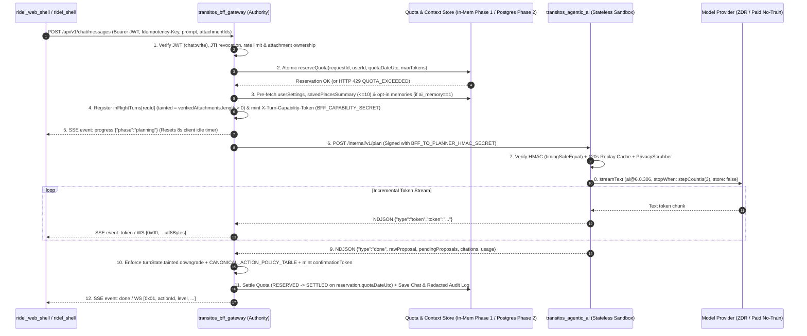
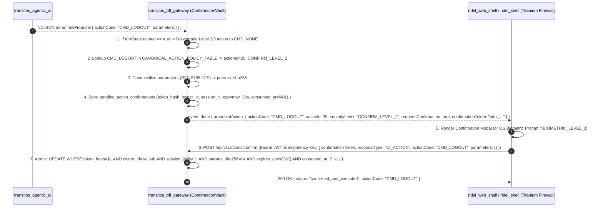
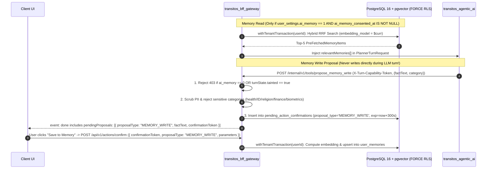
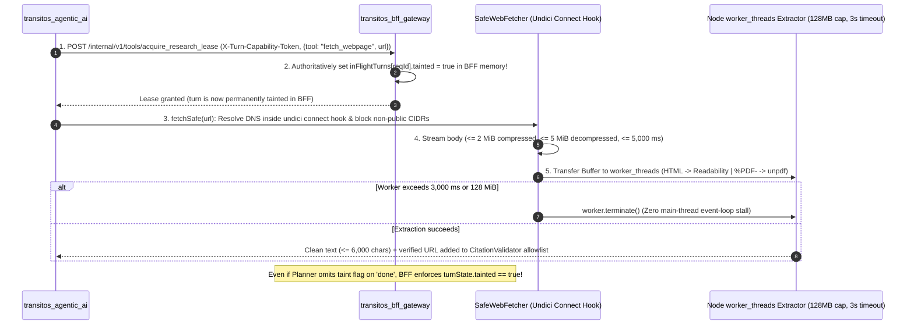
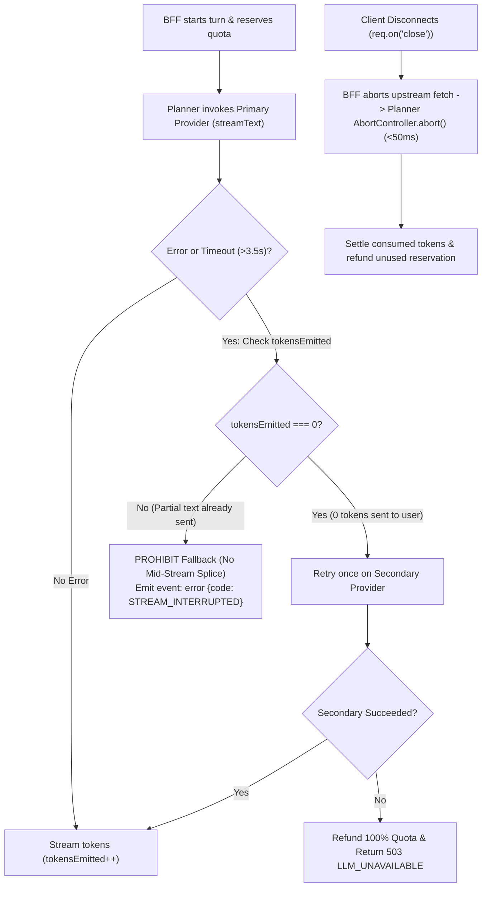
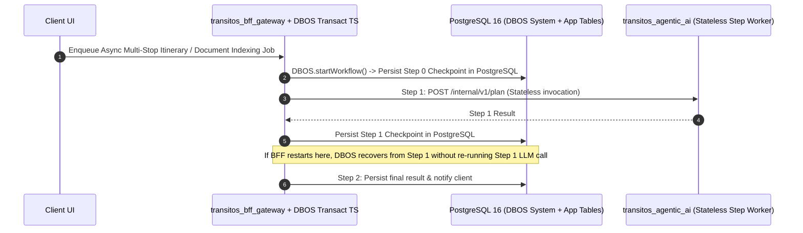

# TRANSITOS Agentic AI — Final System Blueprint & Authoritative Masterplan (`TRANSITOS_AGENTIC_AI_MASTERPLAN.md`)

**Service Name:** `transitos_agentic_ai`  
**Blueprint Revision:** `v3.0` (Final Implementation Blueprint — Synchronized across all 13 Documents)  
**Evaluation Date:** 2026-10-29  
**Architectural Role:** Stateless, Zero-Database-Credential Intent-Planning, Bounded Tool-Calling, Worker-Isolated Document/Web Extraction, and Provider-Routed Reasoning Engine behind `transitos_bff_gateway`

## 1. Executive Summary: What to Build, Who Owns What & Why

This document is the single authoritative implementation blueprint for a solo developer building `transitos_agentic_ai` across Phases 1 through 5. Every contradiction identified during the v1.0 and v2.0 audits (`CDR-001` through `CDR-023`) has been resolved:

1. **What Must Be Built First (Phase 1 Core Slice):**
   - Harden `transitos_bff_gateway` (`AiPlannerClient`, `TurnCapabilitySigner`, `BffActionPolicyGuard`, `InMemoryQuotaLedger`, incremental SSE & `0x00`/`0x01` WebSocket streaming).
   - Build the stateless `transitos_agentic_ai` Node.js 24 LTS + TypeScript 5.9 service with one primary model provider (`@ai-sdk/google` or `@ai-sdk/openai` on pinned **[Vercel AI SDK `ai@^6.0.306`](https://www.npmjs.com/package/ai)** + **[`zod@^3.25.76` / `>=4.0.4`](https://github.com/vercel/ai/issues/7189)**) and two read-only BFF-mediated tools (`get_route_eta`, `get_weather_forecast`, plus optional `list_user_saved_places`).
2. **Strict Separation of Service Authority:**
   - **`transitos_bff_gateway` is the SOLE Persistence, Policy, Taint & Signing Authority:** It owns all database connections (`BffStorageEngine` in Phase 1; PostgreSQL 16 + [`pgvector`](https://github.com/pgvector/pgvector) with `FORCE ROW LEVEL SECURITY` in Phase 2+), user JWT verification, atomic quota reservations, **BFF-only capability-token signing (`BFF_CAPABILITY_SECRET`)**, **authoritative taint tracking (`turnState.tainted`)**, **`CANONICAL_ACTION_POLICY_TABLE` lookup**, and **single-use `ConfirmationVault` redemption (`POST /api/v1/actions/confirm`)**.
   - **`transitos_agentic_ai` is a Stateless, Untrusted Reasoning Sandbox:** It holds **zero database credentials**, **cannot mint or forge `X-Turn-Capability-Token`s** (signed with a secret held exclusively by the BFF), **cannot self-approve actions or clear taint flags**, and runs CPU-bound HTML/PDF extraction inside bounded Node.js `worker_threads` (`resourceLimits: { maxOldGenerationSizeMb: 128 }`).

## 2. Canonical Subsystem Blueprint (In Implementation Order)

Every subsystem below defines its exact purpose, inputs, outputs, owner, dependencies, limits, failure behavior, security invariants, file path, tests, and deployment model:

| # | Subsystem & Implementation Path | Owning Service | Trusted vs. Untrusted Inputs | Outputs & Canonical Contract | Timeouts, Quotas & Retry Rules | Failure & Cancellation Behavior | Enforced Security Invariants & Tests |
| :---: | :--- | :--- | :--- | :--- | :--- | :--- | :--- |
| **S1** | **Split-Key Service Auth & Turn Capability Signer**<br>`transitos_bff_gateway/src/security/turn_capability.js`<br>`transitos_agentic_ai/src/security/service_auth.ts` | **BFF** (mints capability) & **Planner** (verifies BFF HMAC) | **Trusted:** BFF `jwt.sub`, `jwt.jti`, `scopes`.<br>**Untrusted:** Network packets on `/internal/v1/*`. | • **Key 1 (`BFF_TO_PLANNER_HMAC_SECRET`):** Signs `X-Bff-Signature` (`v1\nPOST\n/internal/v1/plan\n...`).<br>• **Key 2 (`BFF_CAPABILITY_SECRET`, BFF-only):** Signs opaque `X-Turn-Capability-Token` (`TTL = turnDeadlineMs`). | • Skew: `±60s`<br>• Replay Cache: `120s` TTL (`max 10,000` entries; fails closed `503` if full)<br>• Phase 1: Single-instance; Phase 2: Postgres `UNLOGGED TABLE internal_request_nonces`. | Rejects (`401`/`403`/`409`) if signature invalid, nonce replayed, or `inFlightTurns.get(reqId)` is closed/aborted. | Planner **never** possesses `BFF_CAPABILITY_SECRET` (`CDR-015`). Verified by `REQ-02` & `REQ-03`. |
| **S2** | **Two-Phase Quota & Idempotency Ledger**<br>`transitos_bff_gateway/src/services/quota_ledger.js` | **`transitos_bff_gateway`** | **Trusted:** `jwt.sub`, `Idempotency-Key`, provider `usage`. | • Reserves `(maxInputTokens + maxOutputTokens)` bound to `(requestId, userId, quotaDateUtc)` **at reservation time**.<br>• Settles actual usage in `finally` (`status: RESERVED -> SETTLED`). | • Default: `150,000` tokens or `$0.50`/UTC day.<br>• Max concurrent in-flight turns/user: `2`.<br>• Midnight-safe via `reservation.quotaDateUtc`. | Fails closed (`429 QUOTA_EXCEEDED` or `503` if store down) before calling planner; refunds 100% if `tokensEmitted === 0`. | Phase 1: Single-instance JS mutex + journal file. Phase 2: Postgres `ai_quota_ledger` + `ai_quota_reservations` (`CDR-018`, `REQ-18`). |
| **S3** | **Pre-Hydrated Turn Context & Privacy Scrubber**<br>`transitos_bff_gateway/src/security/privacy_scrubber.js`<br>`transitos_agentic_ai/src/security/pii_redactor.ts` | **BFF** & **Planner** | **Trusted:** `userSettings`, `savedPlacesSummary` (`<=10`), opt-in `relevantMemories` (`<=5`).<br>**Untrusted:** `prompt`. | `PlannerTurnRequest` JSON envelope with pre-scrubbed prompt (`[REDACTED_CARD]`, `[REDACTED_ID]`, `[REDACTED_TOKEN]`). | `< 2 ms` synchronous regex + [Presidio](https://github.com/microsoft/presidio) pattern pass; `0` retries. | If `PROVIDER_PRIVACY_TIER` is unverified in `production`, refuses to boot (`503`). | Eliminates extra tool round-trip on saved-place routing (`ADR-AI-006`, `REQ-19`). |
| **S4** | **Bounded Stream Orchestrator & Model Router**<br>`transitos_agentic_ai/src/orchestrator/stream_orchestrator.ts` | **`transitos_agentic_ai`** | **Trusted:** BFF envelope.<br>**Untrusted:** `prompt`, tool outputs, LLM stream. | Streams NDJSON (`progress`, `token`, `done`, `error`) using **[`ai@^6.0.306`](https://www.npmjs.com/package/ai)** `streamText` with `stopWhen: stepCountIs(3)`. | • Idle frame timeout: `8,000 ms`<br>• Hard turn deadline: `15,000 ms` (`20,000 ms` multimodal)<br>• Pre-token fallback only (`tokensEmitted === 0`). | Client `req.on('close')` triggers `AbortController.abort()` within `< 50 ms`; mid-stream error emits `event: error` (never splices providers). | Enforces `store: false` on OpenAI & paid ZDR/no-log config on Gemini/Vertex (`CDR-022`, `REQ-14`, `REQ-15`). |
| **S5** | **Canonical Action Policy & Confirmation Vault**<br>`transitos_bff_gateway/src/security/action_policy.js`<br>`src/services/confirmation_vault.js` | **`transitos_bff_gateway`** | **Untrusted:** `rawProposal` (`{ actionCode, destination, parameters }`) and `pendingProposals[]` from planner. | Maps `actionCode` in `CANONICAL_ACTION_POLICY_TABLE` (`0..25`), strips spoofed fields, and mints 30s single-use `confirmationToken` bound to RFC 8785 JCS `params_sha256`. | • Confirmation TTL: `30s`<br>• Redeemed via `POST /api/v1/actions/confirm` with `Idempotency-Key`. | Stale, replayed, parameter-altered, or tainted Level 2/3 proposals fail closed (`403`/`409`). | Model never decides `actionId`, `securityLevel`, `requiresConfirmation`, or `confirmationToken` (`CDR-002`, `CDR-019`, `REQ-04`, `REQ-05`). |
| **S6** | **PostgreSQL 16 + `pgvector` Memory Store (`FORCE RLS`)**<br>`transitos_bff_gateway/src/services/pg_memory_store.js`<br>`migrations/002_agentic_memory.up.sql` | **`transitos_bff_gateway` (Phase 2)** | **Trusted:** `jwt.sub`, `ai_memory == 1` & `ai_memory_consented_at IS NOT NULL`.<br>**Untrusted:** Proposed `factText`. | Hybrid RRF search (`halfvec(1536)` + `simple` FTS + `pg_trgm`) under `transitos_app_runtime` (`NOBYPASSRLS`) inside `withTenantTransaction`. | • Query timeout: `1,500 ms`<br>• Default `ai_memory = 0` (`false`)<br>• Writes require user confirmation (`MEMORY_WRITE` proposal). | If `ai_memory == 0` or `turnState.tainted == true`, memory writes are hard-blocked (`403`). | Complete 12-table RLS matrix + composite FK `(attachment_id, owner_id)` (`CDR-004`, `CDR-020`, `REQ-06`..`REQ-09`). |
| **S7** | **SSRF-Safe Web Fetcher, Worker-Thread Extractor & BFF Taint Gate**<br>`transitos_agentic_ai/src/research/safe_fetcher.ts`<br>`src/workers/extractor_worker.ts` | **BFF** (taint lease) & **Planner** (egress fetch + worker parse) | **Untrusted:** Search URLs, HTML pages, web PDFs. | 1. Planner acquires BFF taint lease (`turnState.tainted = true` in BFF).<br>2. `undici.Agent` pins DNS IP at connect time.<br>3. `worker_threads` runs `@mozilla/readability` or [`unpdf`](https://github.com/unjs/unpdf). | • Fetch: `5,000 ms`, `<= 2 MiB` raw, `<= 5 MiB` decompressed.<br>• Worker parse: `3,000 ms` (`worker.terminate()` on hang), `128 MiB` heap. | Blocks all non-public IPs pre-socket (`0` packets sent); `CitationValidator` strips any URL not returned by a tool in that turn. | BFF enforces taint independently of planner boolean (`CDR-021`, `CDR-022`, `REQ-10`..`REQ-13`). |
| **S8** | **Multimodal Image Sanitizer & Attachment Excerpt Pipeline**<br>`transitos_agentic_ai/src/multimodal/image_sanitizer.ts` | **BFF** (ownership) & **Planner** (`sharp` / `unpdf` worker) | **Trusted:** BFF-verified `att_srv_<hex>` owned by `jwt.sub`.<br>**Untrusted:** File bytes. | [Sharp](https://github.com/lovell/sharp) (`limitInputPixels: 16_777_216`) strips EXIF & re-encodes WebP/PNG; `unpdf` worker extracts `<= 20` pages. | • Upload: `<= 10 MiB`<br>• Image: `<= 16 MP`<br>• PDF: `<= 20` pages, `3,000 ms` worker timeout. | Sets `turnState.tainted = true` when untrusted document text is ingested; rejects `MZ`/`ELF` and pixel bombs (`413`/`415`). | Never indexes attachment chunks into `pgvector` when `ai_memory == 0` (`REQ-17`). |

## 3. Seven Canonical Architecture & Sequence Diagrams

### 3.1 Diagram 1 — Authentication, Quota Reservation & Main Chat Request Lifecycle


### 3.2 Diagram 2 — BFF-to-Planner-to-Tool Callback Lifecycle (Zero Confused Deputy)
```mermaid
sequenceDiagram
  autonumber
  participant Planner as transitos_agentic_ai
  participant BFF as transitos_bff_gateway (/internal/v1/tools/*)
  participant Spatial as Routing / Weather Adapter

  Note over Planner,BFF: Planner holds opaque X-Turn-Capability-Token (cannot forge; lacks BFF_CAPABILITY_SECRET)
  Planner->>BFF: POST /internal/v1/tools/get_route_eta (Header: X-Turn-Capability-Token, Body: {destination, avoidTolls})
  BFF->>BFF: 1. Verify HMAC with BFF_CAPABILITY_SECRET (timingSafeEqual)
  BFF->>BFF: 2. Check inFlightTurns.get(token.reqId) is ACTIVE and not expired (< turnDeadlineMs)
  BFF->>BFF: 3. Check token.scopes includes 'routing:read' & bind userId = token.sub (ignores any body userId)
  BFF->>BFF: 4. Increment turnState.toolCallsCount (reject 429 if > 3)
  BFF->>Spatial: 5. Calculate route for (origin, destination, avoidTolls)
  Spatial-->>BFF: { durationText: "46 min", distanceViaText: "19.1 km • No tolls" }
  BFF-->>Planner: 200 OK (Validated Tool Result <= 8 KB)
```

### 3.3 Diagram 3 — Action Proposal, Single-Use Confirmation & Step-Up Execution Lifecycle


### 3.4 Diagram 4 — Opt-In Memory Retrieval & User-Approved Memory Write Lifecycle


### 3.5 Diagram 5 — External Web Retrieval, Worker-Thread Extraction & BFF-Authoritative Taint Enforcement


### 3.6 Diagram 6 — Model Failure, Pre-First-Token Fallback, Timeout & Client Disconnect Cancellation


### 3.7 Diagram 7 — Phase 5 Durable Background Workflows (`DBOS` Owned by BFF / Core Workers)

