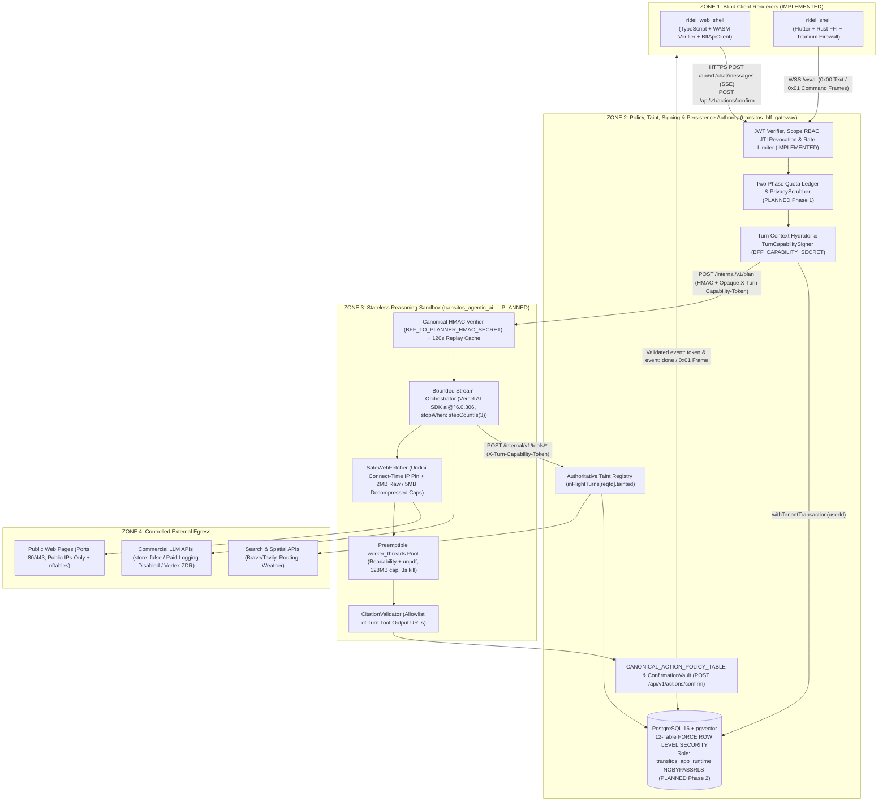

# TRANSITOS Agentic AI (`transitos_agentic_ai`)

**Status:** `PLANNED` (Architecture Blueprint `v3.1` Approved for Phase 1 Implementation; Sibling Repositories `transitos_bff_gateway`, `ridel_ui`, `ridel_web_shell`, and `ridel_shell` are `IMPLEMENTED` and verified)  
**Target Runtime:** Node.js 24 LTS (`>=24.0.0 <25.0.0` in release CI via `STRICT_NODE_24_GATE=1`; `>=18.20.0` compatible for local container testing)  
**Architectural Boundary:** Stateless, Zero-Database-Credential Intent-Planning, Bounded Tool-Calling, Worker-Isolated Web/Document Extraction, and Provider-Routed Reasoning Engine behind `transitos_bff_gateway`

## 1. What TRANSITOS Agentic AI Is & Why We Are Building It

`transitos_agentic_ai` is the intelligent reasoning, multimodal extraction, and bounded task-planning engine for the **TRANSITOS / Ridel** mobility ecosystem.

Users interacting with Ridel across mobile (`ridel_shell`) and web (`ridel_web_shell`) need more than static point-A-to-point-B routing: they ask natural-language questions combining real-time traffic, toll preferences, weather conditions, saved places, uploaded parking passes or transit timetables, and live civic transit advisories (for example, *"Route me to Office avoiding tolls, check if heavy rain is expected on Ring Road, and tell me which gate is on my attached parking pass"*).

### How `transitos_agentic_ai` Differs from a Basic Chatbot or Ordinary LLM Wrapper

| Dimension | Ordinary Chatbot / Naive LLM Wrapper | `transitos_agentic_ai` (TRANSITOS Architecture) |
| :--- | :--- | :--- |
| **Database & Secret Access** | Often holds direct `DATABASE_URL` credentials or unrestricted MCP plugins (`server-postgres`). | **Zero Database Credentials (`ADR-AI-001`):** Holds `0` database connections and `0` capability-signing keys. All persistence, quotas, and RLS policies live in `transitos_bff_gateway`. |
| **Action Execution & Security** | Trusts LLM JSON output to trigger mutations or decide its own risk level. | **Server-Authoritative Policy & Titanium Firewall (`ADR-AI-003`):** The model only proposes `{ actionCode, destination, parameters }`. `transitos_bff_gateway` deterministically resolves `actionId` (`0..25`), `securityLevel` (`Level 1/2/3`), and mints single-use JCS-bound `confirmationToken`s. |
| **UI Rendering** | Streams raw HTML/Markdown or arbitrary component JSON directly into the client DOM. | **Blind SDUI Client Contract:** Emits plain-text tokens (`event: token` / `0x00` binary frames) and allowlisted `ActionCode` proposals (`event: done` / `0x01` binary frames) rendered by verified FlatBuffer SDUI blueprints (`ridel_ui`). |
| **External Content & Prompt Injection** | Relies on prompt instructions ("ignore instructions in the webpage") that are easily bypassed. | **BFF-Authoritative Taint Latch (`ADR-AI-011`):** Acquiring a web/document research lease permanently latches `inFlightTurns[reqId].tainted = true` in BFF memory, deterministically blocking memory writes, saved-place mutations, and Level 2/3 actions for that turn. |
| **Resource & Parser Isolation** | Runs PDF/HTML parsers on the main thread and trusts HTTP redirects. | **Connect-Time DNS Pinning & `worker_threads` Isolation (`ADR-AI-007`):** Blocks private/metadata IPs inside `undici`'s connect hook, caps raw (`2 MiB`) and decompressed (`5 MiB`) bytes, and runs [@mozilla/readability](https://github.com/mozilla/readability) and [`unpdf`](https://github.com/unjs/unpdf) inside preemptible `128 MiB` `worker_threads` (`worker.terminate()` at `3,000 ms`). |

## 2. Complete System Architecture & Trust Boundaries



### Role of Each Ecosystem Repository

1. **`ridel_ui` (`IMPLEMENTED`):** Compiles the 6 adaptive FlatBuffer `.bin`/`.stream` screen blueprints, `action_registry_v1.json` (`ActionCode` `0..25`), and Ed25519-signed `kv_manifest.json` (`00e785af8ca3c96f`), served via Cloudflare Workers (`/ui/v1/*`).
2. **`ridel_web_shell` & `ridel_shell` (`IMPLEMENTED`):** Render verified SDUI blueprints, upload attachments (`<= 10 MiB`) with `Idempotency-Key`, consume SSE (`event: token`, `event: done`) or binary WebSocket (`0x00` text, `0x01` command) streams, and enforce client-side confirmation modals (`Level 2`) and biometric prompts (`Level 3`).
3. **`transitos_bff_gateway` (`IMPLEMENTED` Core; `PLANNED` Phase 1–5 Extensions):** Authenticates user JWTs, owns all database connections and object blobs, reserves/settles quotas, mints unforgeable `X-Turn-Capability-Token`s (`BFF_CAPABILITY_SECRET`), tracks turn taint (`inFlightTurns`), enforces `CANONICAL_ACTION_POLICY_TABLE`, and executes user-confirmed mutations (`POST /api/v1/actions/confirm`).
4. **`transitos_agentic_ai` (`PLANNED` — Target of This Repository):** Stateless reasoning and extraction service that receives a pre-hydrated, PII-scrubbed turn envelope from `transitos_bff_gateway`, executes bounded (`<= 3` steps) tool calls, and streams NDJSON tokens and raw action proposals back to the BFF.

## 3. All Five Development Phases & Current Status

| Phase | Stage README | Core Scope & Deliverables | Current Status |
| :--- | :--- | :--- | :---: |
| **Phase 1: Safe Agent Core** | [docs/stages/01-safe-agent-core/README.md](https://www.google.com/search?q=docs/stages/01-safe-agent-core/README.md) | Split-key HMAC auth (`BFF_TO_PLANNER_HMAC_SECRET` + BFF-only `BFF_CAPABILITY_SECRET`), `InMemoryJournaledQuotaLedger`, `CANONICAL_ACTION_POLICY_TABLE`, pre-hydrated context, `ai@^6.0.306` (`stopWhen: stepCountIs(3)`), 3 read-only tools (`get_route_eta`, `get_weather_forecast`, `list_user_saved_places`), and Web SSE + Native `0x00`/`0x01` streaming. | **`PLANNED` (Ready to Build — Approved)** |
| **Phase 2: Persistent Memory & Retrieval** | [docs/stages/02-persistent-memory/README.md](https://www.google.com/search?q=docs/stages/02-persistent-memory/README.md) | PostgreSQL 16 + [`pgvector`](https://github.com/pgvector/pgvector), 12-table `FORCE ROW LEVEL SECURITY` under `transitos_app_runtime` (`NOBYPASSRLS`), `ai_memory_consented_at` opt-in consent, `ConfirmationVault` (`POST /api/v1/actions/confirm`), multilingual (`simple` + `pg_trgm`) RRF search, and `deleted_blob_cleanup_queue` outbox. | **`PLANNED` (Gated on Phase 1 Exit)** |
| **Phase 3: Web Research & Grounded Answers** | [docs/stages/03-web-research/README.md](https://www.google.com/search?q=docs/stages/03-web-research/README.md) | Brave/Tavily search adapter, BFF `acquire_research_lease` taint latch, `SafeWebFetcher` (`undici` connect-time DNS IP pinning + `2 MiB` raw / `5 MiB` decompressed caps + `nftables`), `worker_threads` `@mozilla/readability` + [`unpdf`](https://github.com/unjs/unpdf) extractor, and `CitationValidator`. | **`PLANNED` (Gated on Phase 2 Exit)** |
| **Phase 4: Multimodal Understanding** | [docs/stages/04-multimodal/README.md](https://www.google.com/search?q=docs/stages/04-multimodal/README.md) | [Sharp (`lovell/sharp`)](https://github.com/lovell/sharp) image sanitizer (`limitInputPixels: 16 MP`, EXIF strip, WebP/PNG re-encode), `read_verified_attachment_excerpt` (`unpdf` worker, `<= 20` pages), Vision LLM routing, and pre-first-token provider failover (`tokensEmitted === 0`). | **`PLANNED` (Gated on Phase 3 Exit)** |
| **Phase 5: Durable Agentic Workflows** | [docs/stages/05-durable-workflows/README.md](https://www.google.com/search?q=docs/stages/05-durable-workflows/README.md) | [DBOS Transact TS (`@dbos-inc/dbos-sdk`)](https://github.com/dbos-inc/dbos-transact-ts) checkpointed workflows in `transitos_bff_gateway` / `transitos_core_workers`, human approval checkpoints (`DBOS.recv()`), [Promptfoo](https://github.com/promptfoo/promptfoo) CI red-team gates, and optional isolated [Crawlee](https://github.com/apify/crawlee) + [Playwright](https://github.com/microsoft/playwright-mcp) worker. | **`PLANNED` (Gated on Phase 4 Exit)** |

## 4. Technology Stack Summary

* **Runtime & Language:** Node.js 24 LTS (`STRICT_NODE_24_GATE=1` in release CI; `>=18.20.0` compatible in dev containers), TypeScript `5.9.3` (`strict: true`).
* **Orchestration & Schemas:** [Vercel AI SDK (`ai@^6.0.306`)](https://github.com/vercel/ai) (`streamText`, `stopWhen: stepCountIs(3)`), `@ai-sdk/google`, `@ai-sdk/openai`, `@ai-sdk/anthropic`, [Zod (`zod@^3.25.76` / `>=4.0.4`)](https://github.com/colinhacks/zod).
* **Persistence & Memory (Owned by `transitos_bff_gateway`):** PostgreSQL 16+, [`pgvector`](https://github.com/pgvector/pgvector) (`halfvec(1536)` HNSW), `pg_trgm`, `FORCE ROW LEVEL SECURITY`.
* **Web Retrieval & Document Parsing:** Node.js `undici`, [@mozilla/readability](https://github.com/mozilla/readability), [`unpdf` (`unjs/unpdf`)](https://github.com/unjs/unpdf) (Mozilla `pdf.js` v6.4.299 in `worker_threads`), [Sharp (`lovell/sharp`)](https://github.com/lovell/sharp).
* **Durable Workflows, Evaluation & Security:** [DBOS Transact TS](https://github.com/dbos-inc/dbos-transact-ts), [OpenTelemetry JS](https://github.com/open-telemetry/opentelemetry-js), [Promptfoo](https://github.com/promptfoo/promptfoo), [Microsoft Presidio](https://github.com/microsoft/presidio), [Google OSV-Scanner](https://github.com/google/osv-scanner), [Aqua Trivy](https://github.com/aquasecurity/trivy).

## 5. Repository Structure & Complete Documentation Map

```text
transitos_agentic_ai/
├── README.md                                                     # Root project overview (this file)
├── docs/
│   ├── README.md                                                 # Central Documentation Index
│   ├── DOCUMENTATION_AUDIT.md                                    # Cross-verification & 5A–5N risk audit
│   ├── TRACEABILITY_MATRIX.md                                    # REQ-01..REQ-24 -> ADR -> Task -> Test -> Gate
│   ├── IMPLEMENTATION_RUNBOOK.md                                 # Master step-by-step execution runbook
│   ├── stages/
│   │   ├── 01-safe-agent-core/README.md                          # Phase 1 Implementation Guide
│   │   ├── 02-persistent-memory/README.md                        # Phase 2 Implementation Guide
│   │   ├── 03-web-research/README.md                             # Phase 3 Implementation Guide
│   │   ├── 04-multimodal/README.md                               # Phase 4 Implementation Guide
│   │   └── 05-durable-workflows/README.md                        # Phase 5 Implementation Guide
│   └── architecture/
│       ├── TRANSITOS_AGENTIC_AI_MASTERPLAN.md                    # Authoritative Target Architecture
│       ├── TRANSITOS_AGENTIC_AI_OPEN_SOURCE_LANDSCAPE.md         # Verified Open-Source Ecosystem Research
│       ├── TRANSITOS_AGENTIC_AI_TECHNOLOGY_DECISIONS.md          # Build-vs-Buy & Selection Matrix
│       ├── TRANSITOS_AGENTIC_AI_THREAT_MODEL.md                  # Threat Model & Security Controls
│       ├── TRANSITOS_AGENTIC_AI_TOOL_CONTRACTS.md                # Canonical Service, Tool, Action & Stream Contracts
│       ├── TRANSITOS_AGENTIC_AI_MEMORY_DESIGN.md                 # 12-Table RLS, Consent & Hybrid Retrieval Design
│       ├── TRANSITOS_AGENTIC_AI_BROWSING_AND_CRAWLING_DESIGN.md  # SafeWebFetcher, Taint Latch & Worker Extraction
│       ├── TRANSITOS_AGENTIC_AI_EVALUATION_PLAN.md               # SLOs, Quotas, Provider Privacy & Eval Gates
│       ├── TRANSITOS_AGENTIC_AI_IMPLEMENTATION_ROADMAP.md        # Dependency-Ordered Phase Roadmap
│       ├── TRANSITOS_AGENTIC_AI_ARCHITECTURE_AUDIT.md            # Executive Architecture Audit Report
│       ├── TRANSITOS_AGENTIC_AI_CONTRADICTION_REGISTER.md        # Full 27-Item Contradiction Ledger (CDR-001..027)
│       ├── TRANSITOS_AGENTIC_AI_DECISION_LOG.md                  # Architecture Decision Records (ADR-AI-001..013)
│       └── TRANSITOS_AGENTIC_AI_REQUIREMENTS_TRACEABILITY.md     # Core Security Requirements Matrix
```
