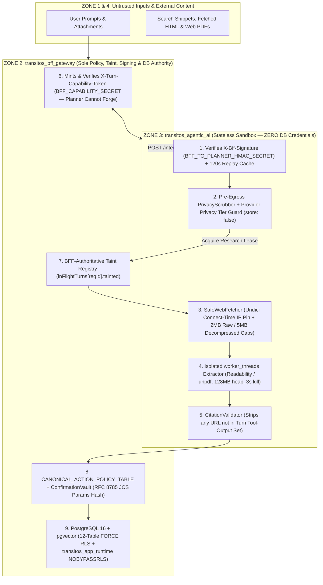

# TRANSITOS Agentic AI — Final Threat Model & Defense-in-Depth Architecture (`TRANSITOS_AGENTIC_AI_THREAT_MODEL.md`)

**Evaluation Date:** 2026-10-29 (`Revision v3.0` — Final Implementation Blueprint)  
**Core Security Invariant:** `transitos_bff_gateway` never trusts `transitos_agentic_ai` to enforce authorization, mint capability tokens, determine action security levels, or self-report whether a turn consumed hostile external content.

## 1. Trust Boundaries & Enforcing Authorities

## 2. Authoritative Threat-to-Control Matrix (`THR-01` through `THR-11`)

| Threat ID | Threat & Attack Scenario | v2.0 Gap Closed in v3.0 (`CDR-*`) | Authoritative Technical Control (`v3.0`) | Deterministic Verification Gate (`REQ-*`) |
| :--- | :--- | :--- | :--- | :--- |
| **`THR-01`** | **Forged Turn Capability Token by Compromised Planner:** Compromised planner attempts to sign its own `X-Turn-Capability-Token` for `user_victim` using the shared `INTERNAL_SERVICE_TOKEN`. | **`CDR-015` (`P0`)**: v2.0 used one symmetric secret for both directions. | **Split Directional Secrets (`ADR-AI-002 v3.0`):** BFF signs `X-Turn-Capability-Token` using `BFF_CAPABILITY_SECRET` (held **exclusively** by BFF; never present in planner env). Planner only holds `BFF_TO_PLANNER_HMAC_SECRET`. | `REQ-03`: Attempt to sign capability token with `BFF_TO_PLANNER_HMAC_SECRET` -> rejected (`HTTP 401/403`) by BFF. |
| **`THR-02`** | **Planner Lies About `taintedByExternalContent` After Reading Hostile Web/PDF Content:** Prompt-injected or buggy planner fetches a malicious webpage and returns `"taintedByExternalContent": false` in its `done` frame to bypass the Level 2/3 action downgrade. | **`CDR-021` (`P0`)**: v2.0 relied on the planner reporting `taintedByExternalContent`. | **BFF-Authoritative Taint Tracking (`ADR-AI-011 v3.0`):** `transitos_bff_gateway` sets `inFlightTurns.get(reqId).tainted = true` in BFF memory whenever: (a) the turn includes any attachment, (b) `recentConversation` contains a tainted message, or (c) the planner calls `/internal/v1/tools/acquire_research_lease` (required before search/fetch). BFF computes `finalTainted = bffTurnState.tainted \|\| plannerReportedTaint` (monotonic latch). | `REQ-10`: Mock planner acquires research lease, then sends `done` with `taintedByExternalContent: false` and `CMD_LOGOUT` -> BFF still enforces `turnState.tainted === true` and downgrades to `CMD_NONE`. |
| **`THR-03`** | **Indirect Prompt Injection Poisoning Persistent Memory or Saved Places:** Untrusted webpage or PDF instructs the model to call `propose_memory_write` or `propose_saved_place_upsert`. | **`CDR-019` (`P0`)**: v2.0 allowed direct writes or lacked a unified confirmation contract. | 1. **Hard Block on Tainted Turns:** BFF rejects `propose_memory_write` and `propose_saved_place_upsert` (`HTTP 403`) whenever `turnState.tainted === true`. 2. **Proposal-Only Pattern (`ADR-AI-003 v3.0`):** Even on untainted turns, `propose_memory_write` and `propose_saved_place_upsert` only create pending proposals in `pending_action_confirmations`, requiring explicit user confirmation via `POST /api/v1/actions/confirm`. | `REQ-05`, `REQ-10`: Verify zero rows inserted into `user_memories` or `saved_places` until `POST /api/v1/actions/confirm` is called with a valid single-use `confirmationToken`. |
| **`THR-04`** | **Firewall Spoofing & Confirmation Replay / Parameter Tampering:** LLM outputs `requiresConfirmation: false` on `CMD_BOOK_NOW`, or an attacker alters `parameters` when redeeming `confirmationToken`. | **`CDR-002`, `CDR-019` (`P0`)** | `CANONICAL_ACTION_POLICY_TABLE` in BFF overrides all security metadata; `ConfirmationVault` binds `params_sha256` over RFC 8785 canonical JSON and atomically marks `consumed_at = NOW()`. | `REQ-04`, `REQ-05`: Spoofed fields, replayed tokens (`409`), and mutated parameters (`403`) rejected. |
| **`THR-05`** | **PostgreSQL Table-Owner RLS Bypass on Migration `001` & `002` Tables:** Queries on `user_profiles`, `saved_places`, `attachments`, or `user_memories` bypass RLS or link cross-tenant attachment chunks. | **`CDR-004`, `CDR-020` (`P0`)**: v2.0 omitted RLS on Migration `001` tables. | **Complete 12-Table RLS Matrix (`ADR-AI-004 v3.0`):** `ENABLE` + `FORCE ROW LEVEL SECURITY` on all 10 tenant tables across Migrations `001` and `002`, executed under `transitos_app_runtime` (`NOBYPASSRLS`) via `withTenantTransaction`, plus composite FK `(attachment_id, owner_id)`. | `REQ-06`, `REQ-07`: Automated SQL audit of `pg_class` (`relrowsecurity` & `relforcerowsecurity`) across all 10 tenant tables. |
| **`THR-06`** | **SSRF, DNS Rebinding, Compressed Gzip Bombs & Missing Kernel Egress Filter:** Attacker targets `169.254.169.254`, uses DNS rebinding, serves a 10 KB gzip bomb that decompresses to 4 GB, or bypasses app-level fetch. | **`CDR-021` (`P0`)**: v2.0 capped raw bytes (`2 MiB`) without capping decompressed stream bytes or kernel egress. | 1. **Connect-Time DNS Pinning in `undici.Agent`** blocking all non-public IPv4/IPv6/mapped ranges. 2. **Dual Stream Byte Caps:** `<= 2 MiB` compressed socket bytes **and** `<= 5 MiB` decompressed bytes via a Transform counter stream. 3. **OS/Container Egress Firewall (`nftables`):** Blocks outbound packets from the planner container to RFC 1918, loopback, link-local (`169.254.0.0/16`), and CGNAT ranges at the Linux kernel level. | `REQ-11`: SSRF, DNS-rebinding, and 10x gzip-bomb unit tests (`100%` aborted before exceeding `5 MiB`). |
| **`THR-07`** | **CPU Event-Loop Starvation (ReDoS / Pathological DOM or PDF):** A complex 2 MiB HTML table or 20-page PDF stalls `@mozilla/readability` or `unpdf` on the main Node.js thread for 10+ seconds, freezing all concurrent SSE streams. | **`CDR-022` (`P1`)**: [`unpdf` docs](https://github.com/unjs/unpdf) warn that serverless `pdf.js` runs on the main event loop. | **Preemptible `worker_threads` Isolation (`ADR-AI-007 v3.0`):** Both `@mozilla/readability` and `unpdf` execute inside a bounded Node.js `worker_threads` pool (`maxWorkers = 2`, `resourceLimits: { maxOldGenerationSizeMb: 128 }`). If a worker exceeds `3,000 ms`, the parent calls `await worker.terminate()` and spawns a fresh worker—keeping main-thread event-loop lag `< 5 ms`. | `REQ-12`: Synthetic infinite-loop/heavy-PDF worker test verifying `worker.terminate()` fires at `3,000 ms` while concurrent health/SSE requests respond in `< 20 ms`. |
| **`THR-08`** | **Quota Bypass Across Midnight UTC Boundaries or Concurrent Bursts:** Requests spanning `23:59:59 UTC` or parallel bursts corrupt `reserved_tokens` or settle twice. | **`CDR-018` (`P0`)** | **Request-Bound Reservation Records (`ADR-AI-009 v3.0`):** Every reservation records `(request_id, owner_id, quota_date_utc, reserved_tokens, status = 'RESERVED')`. Settlement updates the exact `quota_date_utc` row and transitions `status -> 'SETTLED'` idempotently (`WHERE status = 'RESERVED'`). | `REQ-18`: Concurrent burst test, midnight clock-rollover test, and duplicate `settleQuota(reqId)` idempotency test. |
| **`THR-09`** | **Unverified Provider Data Retention / Training Leak:** Production deployment accidentally uses a free-tier Gemini key or OpenAI call without `store: false`, causing user prompts to be stored for 55 days or used for training. | **`CDR-022` (`P1`)**: Oct 26, 2026 Gemini API default storage change & OpenAI `store: false` requirement. | **Provider Privacy Tier Enforcement (`ADR-AI-008 v3.0`):** `ModelRouter` passes `store: false` on OpenAI calls, requires paid/Vertex ZDR configuration on Google calls, and refuses to start in `production` unless `PROVIDER_PRIVACY_ATTESTATION` (`ZDR` or `PAID_NO_TRAIN_LOGGING_DISABLED`) is explicitly set. | `REQ-19`, `REQ-20`: Startup config guard + outbound request body test asserting `store: false`. |
| **`THR-10`** | **Legacy Users Silently Opted Into Long-Term Memory:** Changing `ALTER COLUMN ai_memory SET DEFAULT 0` leaves existing rows in `user_settings` at `ai_memory = 1` without explicit user consent. | **`CDR-020` (`P0`)** | **Explicit Consent Timestamp (`ai_memory_consented_at`, `ADR-AI-008 v3.0`):** Migration `002` adds `ai_memory_consented_at TIMESTAMPTZ DEFAULT NULL` and resets `UPDATE user_settings SET ai_memory = 0 WHERE ai_memory_consented_at IS NULL`. Memory is active only when `ai_memory == 1 AND ai_memory_consented_at IS NOT NULL`. | `REQ-08`: Migration test seeding legacy `ai_memory = 1` rows and verifying they are reset to `0` until explicit opt-in. |
| **`THR-11`** | **Hallucinated Citation URLs & Mid-Stream Provider Splicing:** Model invents fake URLs or switches providers after partial tokens were already rendered. | **`CDR-005`** | `CitationValidator` strips any URL not returned by a tool in the current turn (`REQ-13`), and `ModelRouter` forbids fallback when `tokensEmitted > 0` (`REQ-14`). | `REQ-13`, `REQ-14`: Deterministic unit tests. |
